# Air Quality Permit Modeling for a New Major Source: An NSR/PSD Dispersion Analysis with AERMOD and an Hourly Gaussian Model

In this project, I carry out the air quality part of a Prevention of Significant Deterioration (PSD) permit review for a new industrial stack, the way it is done for a permit application in the United States. The facility, *Apex Industrial Power & Steam, Unit B1*, is a hypothetical case placed in eastern Pennsylvania near Martins Creek, with the meteorological station at Allentown (KABE). The project has two parts, and both are complete:

* **Part A:** an hour-by-hour Gaussian plume model that I built in Python in the style of ISCST3, EPA's regulatory model before AERMOD. It runs over five years of hourly weather (43,824 hours) at 3,225 receptors, builds every design value in its correct statistical form, and compares it with the significant impact levels, the National Ambient Air Quality Standards (NAAQS) and the PSD increments. It first runs on a synthetic five-year weather file that I generated with AERMET's own boundary-layer equations, and then on the real AERMET data from Part B.
* **Part B:** the complete EPA AERMOD modeling system with real 2021–2025 data: AERSURFACE, AERMINUTE, AERMET, AERMAP, BPIPPRM and AERMOD. Every input file is written from the same project definition as Part A. A comparison then runs the Part A model on the same AERMET data and compares the two models receptor by receptor, and ten extra AERMOD runs switch building downwash and terrain off to find out where the differences come from.

I formulated the project from EPA's *Guideline on Air Quality Models* (40 CFR Part 51, Appendix W), the AERMOD formulation and user's guides, EPA permit modeling guidance, and textbooks on air pollution meteorology and dispersion (Turner, 1994; Arya, 1999; De Visscher, 2014; Seinfeld & Pandis, 2016). The facility and its emissions are invented for learning; the standards, significance levels and increments are the real values in force in November 2026.

## Key Findings

* **With AERMOD and the real weather, the project fails at this site.** It exceeds the 1-hour SO₂ and NO₂ NAAQS, both PM₂.₅ NAAQS, both secondary SO₂ standards and four Class II increments. Meeting the 1-hour SO₂ NAAQS would take about 92 % less SO₂, or another site.
* **The cause is a ridge next to the plant.** The ground 0.4–0.6 km south-east of the stack is 100–130 m above the stack base, about as high as the plume. In stable hours AERMOD carries the plume straight into the hillside, and the design values jump 20–40 times.
* **The simple model is not wrong, it is blind to hills.** With terrain switched off, AERMOD and the Part A model agree within about a factor of 2. Building downwash matters only within about 0.4 km of the stack.

| Design value (µg/m³, project only) | Limit | Part A model | AERMOD, flat ground | AERMOD, regulatory run (terrain + downwash) |
| :--- | ---: | ---: | ---: | ---: |
| SO₂ 1-hour (4th-highest daily max, 5-year average) | 196.4 | 61 | 46–66 | **2,400** |
| NO₂ 1-hour, ARM2 (8th-highest daily max, 5-year average) | 188 | 31 | 25–35 | **758** |
| Primary PM₂.₅ 24-hour (8th-highest, 5-year average) | 35 | 0.48 | 0.83–0.88 | **12.3** |

All columns use the same real 2021–2025 weather and the same 3,225 receptors. The limits are the NAAQS before background is added.

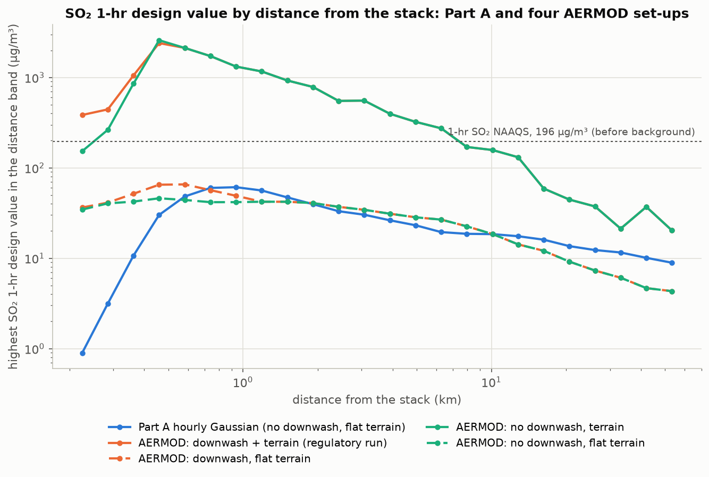

The full Part B report, with the data checks and every problem fixed along the way, is in [RESULTS_AERMOD.md](RESULTS_AERMOD.md).

Before the case study, let's go through the concepts the analysis rests on.

## Basic Concepts and Terms

### Air Quality Standards and Design Values

The Clean Air Act requires EPA to set **National Ambient Air Quality Standards (NAAQS)** for six common ("criteria") pollutants. *Primary* standards protect public health; *secondary* standards protect public welfare (vegetation, soils, water, visibility). Every standard has four parts:

* **Indicator:** the pollutant measured, e.g. SO₂, NO₂, PM₂.₅ (particles smaller than 2.5 µm).
* **Averaging time:** 1 hour, 24 hours, a year, and so on.
* **Level:** the concentration, in ppb or µg/m³.
* **Form:** the statistic compared with the level. The 1-hour SO₂ standard, for example, is not "never above 75 ppb"; it is the 99th percentile of the daily maximum 1-hour values, averaged over three years.

The value of that statistic, computed from monitored or modeled concentrations, is the **design value**. A model gives a concentration for every hour at every receptor; the design value is built from those hourly results in exactly the same way as from monitor data (see [Design Values](#design-values-in-modeling) below).

| Pollutant | Averaging time | Level | Form |
| :--- | :--- | :--- | :--- |
| SO₂ | 1-hour (primary) | 75 ppb (196.4 µg/m³) | 99th percentile of the daily maximum 1-hour values, averaged over 3 years |
| SO₂ | 3-hour (secondary, 1971) | 0.5 ppm (1,300 µg/m³) | not to be exceeded more than once per year |
| SO₂ | annual (secondary, 2024) | 10 ppb (26.2 µg/m³) | annual mean, averaged over 3 years |
| NO₂ | 1-hour (primary) | 100 ppb (188 µg/m³) | 98th percentile of the daily maximum 1-hour values, averaged over 3 years |
| NO₂ | annual | 53 ppb (100 µg/m³) | annual mean |
| PM₂.₅ | 24-hour | 35 µg/m³ | 98th percentile, averaged over 3 years |
| PM₂.₅ | annual (primary, 2024) | 9.0 µg/m³ | annual mean, averaged over 3 years |

Gas concentrations convert between the two units at 25 °C and 1 atm:

$$
C\ [\mu\text{g/m}^3] = C\ [\text{ppb}] \times \frac{M}{24.45}
$$

where $M$ is the molecular weight (64.07 g/mol for SO₂, 46.01 for NO₂, 48.00 for O₃) and 24.45 L/mol is the molar volume of air.

Two recent changes matter for this project. In 2024, EPA lowered the primary annual PM₂.₅ standard from 12.0 to 9.0 µg/m³ (89 FR 16202). In December 2024, EPA added an annual secondary SO₂ standard of 10 ppb (89 FR 105692); the 1971 3-hour secondary standard stays in effect. EPA's alternative demonstration approaches let a PSD applicant rely on the 1-hour primary SO₂ demonstration for both secondary standards, but the 3-hour values are still needed for the SO₂ increment.

### New Source Review and PSD

**New Source Review (NSR)** is the preconstruction permit program of the Clean Air Act. A new **major stationary source** must get a permit before construction starts:

* In an area that meets the NAAQS (attainment or unclassifiable), the permit is a **PSD** permit (40 CFR 52.21). In an area that violates a standard, it is a Nonattainment NSR permit.
* A source is major if its potential to emit any regulated pollutant is at least **100 tons per year** for 28 listed source categories, including fossil fuel-fired steam electric plants of more than 250 MMBtu/h heat input, or at least **250 tons per year** for all other sources.
* Each pollutant whose emissions increase reaches its **significant emission rate (SER)** is reviewed: 40 tpy for SO₂ and NOx, 10 tpy for direct PM₂.₅ (plus 40 tpy for SO₂ and NOx as PM₂.₅ precursors), 15 tpy for PM₁₀, 100 tpy for CO.

For every reviewed pollutant the applicant must apply the **Best Available Control Technology (BACT)** and show, with dispersion modeling, that the project will not cause or contribute to a violation of a NAAQS or a PSD increment. The modeling part follows the two steps in the figure.

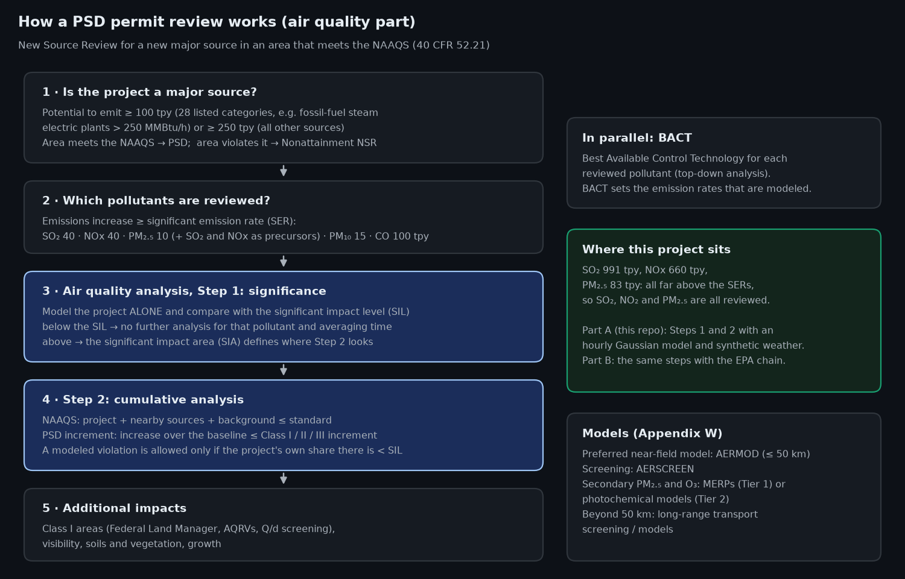

### Significant Impact Levels and the Cumulative Analysis

The **significant impact level (SIL)** is a concentration so small that a project contributing less than it is considered not to cause or contribute to a violation (EPA, 2018). The analysis therefore starts with the project alone:

1. **Significance analysis:** model only the new source and compare its highest impact with the SIL. If it is below, the analysis for that pollutant and averaging time ends.
2. **Cumulative analysis:** if it is above, the receptors where the project exceeds the SIL form the **significant impact area (SIA)**. There, the project is modeled together with **nearby sources** (other sources that could cause a significant concentration gradient in the SIA), and a **background concentration** from representative monitors is added. The total must be below the NAAQS. If a violation appears, the project is still acceptable when its own contribution at that receptor and time is below the SIL.

| Pollutant and averaging time | SIL (µg/m³) | Source |
| :--- | :---: | :--- |
| SO₂ 1-hour | 7.8 (3 ppb) | interim SIL, EPA memorandum (2010) |
| SO₂ 3-hour / 24-hour / annual | 25 / 5 / 1 | 40 CFR 51.165(b)(2) |
| NO₂ 1-hour | 7.5 (4 ppb) | interim SIL, EPA memorandum (2010) |
| NO₂ annual | 1 | 40 CFR 51.165(b)(2) |
| PM₂.₅ 24-hour / annual | 1.2 / 0.13 | EPA SIL guidance (2018) and its 2024 supplement for the 9.0 µg/m³ standard |

### PSD Increments and Area Classes

The NAAQS is a ceiling. In clean areas, the PSD program also limits how much the air may **deteriorate**: the **increment** is the maximum allowed increase over a **baseline concentration**, the concentration in the area when the first PSD application for that pollutant was filed there (the *minor source baseline date*). All emission changes after that date consume increment.

* **Class I** areas (national parks and wilderness areas above a set size) have the smallest increments. They are protected by the Federal Land Managers, who also review *air quality related values* (AQRVs) such as visibility and acid deposition.
* **Class II** covers almost everywhere else, including this site.
* **Class III** allows the largest increments; no area has been redesignated to Class III so far.

Short-term increments may be exceeded once per year, so they are compared with the **highest second-high (H2H)** concentration; annual increments are compared with the highest annual mean.

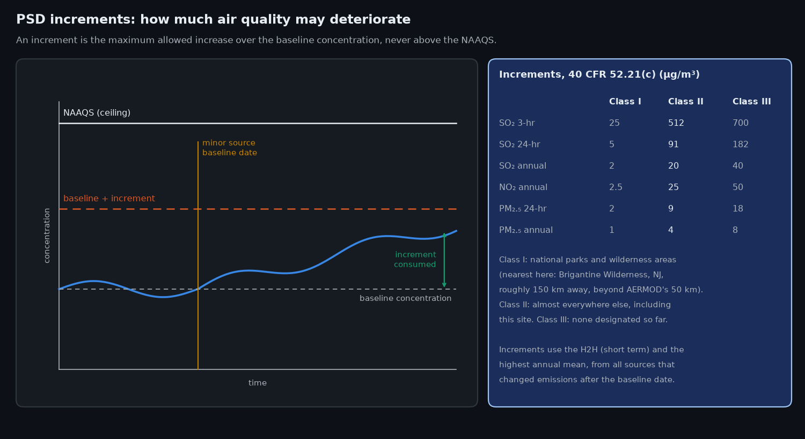

The nearest Class I area to this site is the Brigantine Wilderness in New Jersey, roughly 150 km away, beyond the 50 km range of AERMOD. The Federal Land Managers' first screen there is $Q/d$, the sum of SO₂, NOx, PM₁₀ and H₂SO₄ emissions (tpy) divided by the distance (km); for $Q/d \le 10$ they usually ask for no AQRV analysis (FLAG, 2010). Taking PM₁₀ equal to PM₂.₅ and leaving out H₂SO₄, this project gives $Q/d \approx 1{,}735/150 \approx 12$, so in a real application the Federal Land Managers would be consulted.

### Ambient Air, the Fenceline and Receptors

Standards apply in **ambient air**: the outdoor air to which the general public has access (40 CFR 50.1(e)). Inside a fence, or behind other measures that keep the public out, the air is not ambient air (EPA, 2019). That is why receptors start at the **fenceline**.

A **receptor** is a point where the model computes concentrations. The network must be dense where the highest impacts occur and wide enough to find where impacts fall below the SIL. This project uses 3,225 receptors:

* 56 fenceline receptors every 25 m;
* nested Cartesian grids: 100 m spacing to ±1.5 km, 250 m to ±3 km, 500 m to ±10 km;
* polar rings every 10° at 12.5, 15, 20, 25, 30, 40 and 50 km, to locate the edge of the SIA.

### The Planetary Boundary Layer

Pollutants mix within the **planetary boundary layer**, the lowest part of the atmosphere, which feels the ground. Its structure changes through the day:

* **Daytime (convective boundary layer):** the sun heats the ground, warm air rises in thermals, and strong vertical mixing reaches up to the **convective mixing height** $z_{ic}$, often 1–2 km in summer.
* **Night (stable boundary layer):** the ground cools by radiation, the air near it becomes colder than the air above, and mixing is weak and limited to a shallow layer whose depth is set by wind shear: the **mechanical mixing height** $z_{im}$.

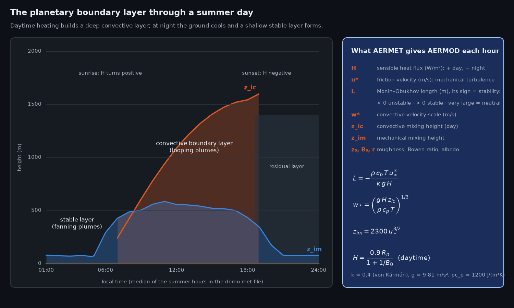

Instead of a single stability class, AERMOD describes each hour with surface-layer scaling parameters that AERMET computes:

* **Sensible heat flux** $H$ (W/m²): heat carried up from the ground by turbulence; positive by day, negative at night.
* **Friction velocity** $u_*$ (m/s): the strength of mechanical turbulence created by wind blowing over rough ground.
* **Monin–Obukhov length** $L$ (m): the height above which buoyancy, rather than wind shear, controls turbulence. $L < 0$ means unstable air, $L > 0$ stable air, and a very large $|L|$ means neutral air.

$$
L = -\frac{\rho\,c_p\,T\,u_*^3}{k\,g\,H}
$$

* $\rho\,c_p$: volumetric heat capacity of air (about 1,200 J/m³K); $T$: air temperature (K); $k = 0.4$: von Kármán constant; $g$: gravitational acceleration.
* **Convective velocity scale** $w_*$ (m/s): the typical speed of thermals, $w_* = \left(g\,H\,z_{ic} / \rho\,c_p\,T\right)^{1/3}$.
* **Surface characteristics:** roughness length $z_0$ (m), Bowen ratio $B_0$ (sensible over latent heat flux; high for dry ground) and albedo $r$ (fraction of sunlight reflected), from land cover via AERSURFACE.

The Pasquill stability classes A–F used in the classic Gaussian plume model and the Monin–Obukhov length describe the same physics. Golder (1972) related the classes to $L$ and $z_0$; the relation is usually written as one line $1/L = a + b\,\log_{10} z_0$ per class, which is how Part A assigns a class to each hour of an AERMET file.

### How AERMOD Models Dispersion

AERMOD is EPA's preferred model for near-field (up to 50 km) dispersion from industrial sources (Appendix W, Section 4.2.2). Like the classic Gaussian plume model, it is a steady-state plume model, but the plume spread comes from the turbulence of each hour ($\sigma_v$, $\sigma_w$ from $u_*$, $w_*$ and $L$) instead of the Pasquill–Gifford curves:

* **Stable boundary layer:** a Gaussian plume in both directions.
* **Convective boundary layer:** updrafts are strong but narrow, while downdrafts are weak but cover about 60 % of the area. The vertical velocity distribution is therefore skewed, and AERMOD represents it with two Gaussian distributions (a *bi-Gaussian* PDF). The plume is split into three parts: a *direct* plume carried down by downdrafts, an *indirect* plume lofted by updrafts and held at $z_i$, and a *penetrated* plume that rises through the top of the mixed layer and re-enters later (Cimorelli et al., 2005).

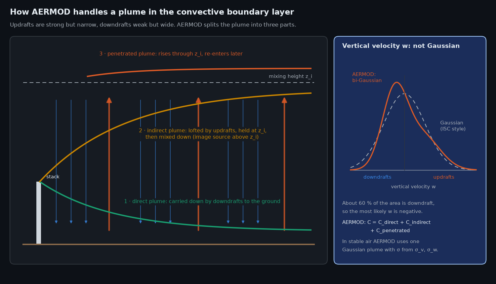

**Terrain** is handled with the **dividing streamline height** $H_c$. In stable flow, air below $H_c$ does not have enough energy to climb over a hill and goes around it, while air above $H_c$ goes over it. AERMOD computes the concentration as a weighted sum of a plume that stays horizontal and a plume that follows the terrain:

$$
C_T = f\,C_{\text{horizontal}} + (1 - f)\,C_{\text{terrain}}, \qquad f = 0.5\,(1 + \phi_p)
$$

where $\phi_p$ is the share of the plume below $H_c$. In convective hours $H_c = 0$, so each state gets half the weight. AERMAP provides each receptor's elevation and its hill height scale $h_c$, the terrain height that controls $H_c$.

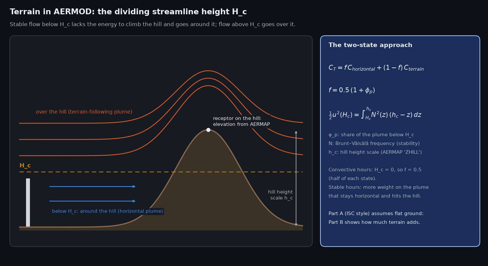

### Building Downwash and GEP Stack Height

Wind blowing over a building creates a turbulent **wake** and, just behind the building, a recirculating **cavity**. A plume released at a height comparable to the building can be pulled down into the wake, producing high ground-level concentrations close to the source. AERMOD models this with the **PRIME** algorithm (Schulman et al., 2000), using building dimensions for 36 wind directions computed by **BPIPPRM**.

Stacks may not be built artificially tall to dilute emissions. The **good engineering practice (GEP)** stack height (40 CFR 51.100(ii)) is the height needed to avoid downwash:

$$
H_{GEP} = H_b + 1.5\,L
$$

* $H_b$: height of the nearby building tier;
* $L$: the lesser of that tier's height and its maximum projected width;
* only buildings within $5L$ of the stack count, and $H_{GEP}$ is never taken below 65 m.

An emission limit may not take credit for stack height above GEP. A stack below GEP is allowed, but downwash must then be modeled.

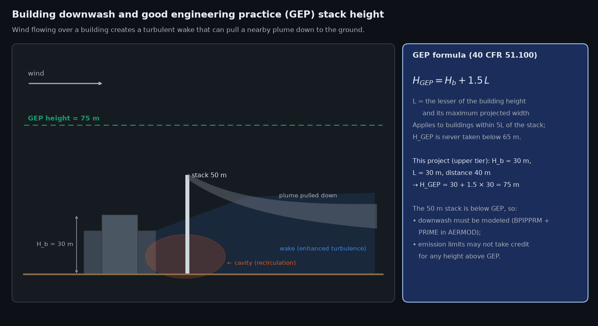

### NO₂: From NOx Emissions to NO₂ Concentrations

Combustion releases nitrogen oxides (NOx) mostly as NO. Downwind, ozone converts NO to NO₂ ($\text{NO} + \text{O}_3 \rightarrow \text{NO}_2 + \text{O}_2$), while sunlight splits NO₂ back. AERMOD offers three tiers (Appendix W, Section 4.2.3.4):

* **Tier 1:** all NOx is NO₂. Simple and most conservative.
* **Tier 2, ARM2 (Ambient Ratio Method 2):** the modeled hourly NOx is multiplied by an ambient NO₂/NOx ratio that falls as NOx rises. Podrez (2015) fitted the ratio to monitoring data as a 6th-order polynomial of NOx (µg/m³); AERMOD limits it to 0.5–0.9 by default.

$$
\begin{aligned}
\frac{\text{NO}_2}{\text{NO}_x} = {} & -1.1723\times10^{-17}x^6 + 4.2795\times10^{-14}x^5 - 5.8345\times10^{-11}x^4 \\
& + 3.4555\times10^{-8}x^3 - 5.6062\times10^{-6}x^2 - 2.7383\times10^{-3}x + 1.2441
\end{aligned}
$$

* **Tier 3:** chemistry limited by the available ozone: OLM (ozone limiting method), PVMRM and GRSM. They need hourly ozone data and the **in-stack ratio** (the NO₂/NOx fraction emitted directly); 0.5 is the conservative value used when no source test data exist (EPA, 2015). The simplest, OLM, for one source:

$$
\text{NO}_2 = \text{ISR}\cdot\text{NO}_x + \min\left[(1 - \text{ISR})\,\text{NO}_x,\ \tfrac{46}{48}\,[\text{O}_3]\right] \le 0.9\,\text{NO}_x
$$

### Secondary PM₂.₅ and MERPs

SO₂ and NOx also form sulfate and nitrate particles in the air over hours, so a large source of these gases adds **secondary PM₂.₅** that AERMOD, which models only directly emitted (primary) particles, cannot see. EPA's permit modeling guidance (EPA, 2022) uses two tiers: Tier 1 with **Modeled Emission Rates for Precursors (MERPs)** and Tier 2 with photochemical grid models. Under the 2024 update of the MERPs guidance, the secondary impact is estimated from a hypothetical source modeled by EPA with a photochemical model:

$$
\text{secondary impact} = \sum_{\text{precursors}} \text{project emissions (tpy)} \times \frac{\text{modeled impact of the hypothetical source}}{\text{its modeled emission rate}}
$$

and added to the modeled primary PM₂.₅ before comparing with the SIL, the NAAQS and the increments.

### Design Values in Modeling

With five years of NWS meteorological data, the five-year average of the modeled statistic takes the place of the three-year average in the form of the standard (EPA memoranda, 2010–2011). The figure follows the 1-hour SO₂ design value step by step; the table lists every form used in this project.

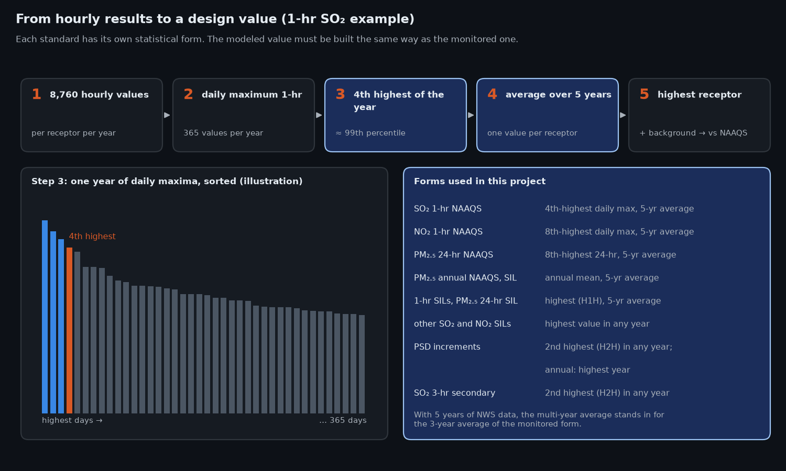

## The AERMOD Modeling System (Part B)

AERMOD needs several preprocessors, each turning raw data into a file the next program reads. In Part B every one of them was run with real data (see [Results (Part B)](#results-part-b-aermod-with-real-data)):

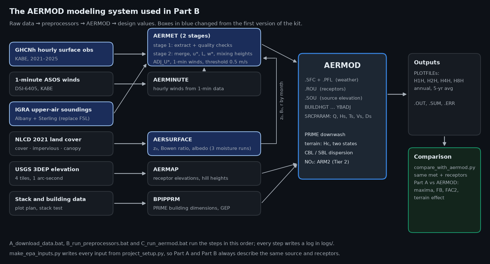

| Program (version) | What it does | Settings in this repository |
| :--- | :--- | :--- |
| AERSURFACE (26135) | $z_0$ by sector within 1 km, and $B_0$ and albedo over a 10 km × 10 km area, around the met station, from land cover | NLCD 2021 land cover, impervious and tree canopy; 12 sectors (`VARYZ0`, all `LOWZ0` for the airfield); monthly; three runs (average, wet, dry surface moisture) |
| AERMINUTE (26135) | hourly winds from 2-minute averages reported every minute by ASOS, which removes most calms and variable winds | 57 monthly KABE files for 2021–2025 (08/2025, 09/2025 and 12/2025 are not in the NCEI archive) |
| AERMET (26135) | stage 1: extract and check the data; stage 2: merge and compute $H$, $u_*$, $L$, $w_*$, $z_{ic}$, $z_{im}$ | GHCNh surface data, IGRA soundings, 1-minute winds, `ADJ_U*`, `THRESH_1MIN 0.5`, cloud and temperature substitution, 12Z Albany soundings with Sterling, VA substituted on days without one (`UPP_SUB SUBUA_SEC1`), randomized wind directions; each year gets the AERSURFACE file of its surface moisture |
| AERMAP (24142) | receptor and source elevations and hill height scales from a DEM | four USGS 3DEP 1 arc-second tiles, 55 km domain, 3,225 receptors |
| BPIPPRM (04274) | building dimensions for PRIME, GEP height | two-tier boiler hall; GEP = 75 m |
| AERMOD (26135) | concentrations and design values | three five-year runs (SO₂ 1-hour; NO₂ 1-hour and annual with ARM2; PM₂.₅ 24-hour and annual) and fifteen one-year runs for the H1H, H2H and annual values; optional Tier 3 OLM run |

## Methodology (Part A)

Part A answers the regulatory questions with a transparent model whose every line can be checked: an hourly Gaussian plume model that follows the ISCST3 formulation (EPA, 1995). It also becomes the baseline against which AERMOD is compared in Part B.

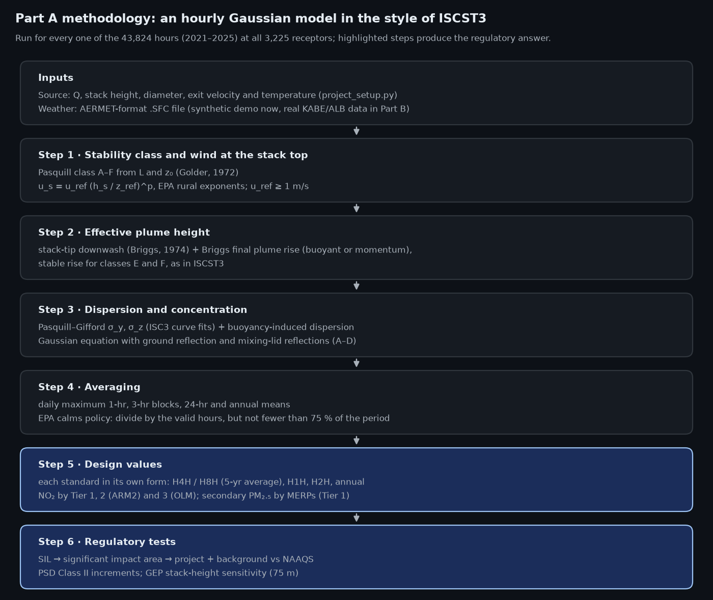

### Step 1: Meteorology

Part A reads any file in the AERMET surface-file format. It runs first on a synthetic five-year file, `SYNTHETIC_DEMO_2021_2025.SFC`, made by `make_demo_met.py`. The weather (temperature, wind, cloud, pressure) is generated from simple climate statistics for the Lehigh Valley, and the boundary-layer parameters are then computed with the equations AERMET uses:

* Net radiation (Holtslag & van Ulden, 1983), with solar elevation $\phi$ and cloud fraction $N$:

$$
R_n = \frac{(1 - r)\,R + c_1\,T^6 - \sigma\,T^4 + c_2\,N}{1 + c_3}, \qquad R = (990\sin\phi - 30)(1 - 0.75\,N^{3.4})
$$

* with $c_1 = 5.31\times10^{-13}$ W/m²K⁶, $c_2 = 60$ W/m², $c_3 = 0.12$ and $\sigma = 5.67\times10^{-8}$ W/m²K⁴.
* Daytime heat flux $H = 0.9\,R_n / (1 + 1/B_0)$; $u_*$ and $L$ by iterating the Monin–Obukhov wind profile with the Paulson (1970) correction.
* Night: $u_*$, $L$ and $H$ from the temperature scale $\theta_* = 0.09\,(1 - 0.5N^2)$ (Venkatram, 1980; van Ulden & Holtslag, 1985).
* Convective mixing height from the heat put into the layer since sunrise, $z_{ic}^2 = 2\,(1 + 2A)\int H\,dt\,/\,(\rho\,c_p\,\gamma)$ with $A = 0.2$ and $\gamma$ the potential temperature gradient above the layer (Carson, 1973; Weil & Brower, 1983).
* Mechanical mixing height $z_{im} = 2300\,u_*^{3/2}$ with AERMET's hourly smoothing.

| Season | $z_0$ (m) | Bowen ratio | Albedo |
| :--- | :---: | :---: | :---: |
| Winter (Dec–Feb) | 0.08 | 1.00 | 0.18 |
| Spring (Mar–May) | 0.09 | 0.60 | 0.16 |
| Summer (Jun–Aug) | 0.12 | 0.60 | 0.17 |
| Autumn (Sep–Nov) | 0.10 | 0.90 | 0.17 |

These are typical values for open grass and airfield; in Part B they come from AERSURFACE. The synthetic file is physically consistent, but it is **not** an observation, so the Part A results with it show the method, not the real impact of a real source. In Part B the same model runs on the real AERMET file (`03_AERMET/KABE_2021_2025.SFC`) for the comparison with AERMOD.

### Step 2: Stability Class

Each hour gets the Pasquill class whose Golder (1972) line $1/L = a + b\,\log_{10} z_0$ is nearest to the observed $1/L$:

| Class | A | B | C | D | E | F |
| :--- | :---: | :---: | :---: | :---: | :---: | :---: |
| $a$ | −0.096 | −0.037 | −0.002 | 0 | 0.004 | 0.035 |
| $b$ | 0.029 | 0.029 | 0.018 | 0 | −0.018 | −0.036 |

### Step 3: Wind at the Stack Top

$$
u_s = u_{ref}\left(\frac{h_s}{z_{ref}}\right)^p
$$

with the EPA rural exponents $p$ = 0.07, 0.07, 0.10, 0.15, 0.35, 0.55 for classes A–F. As in ISCST3, reference winds below 1 m/s are set to 1 m/s; calm hours (wind below the 0.5 m/s threshold) are not modeled.

### Step 4: Effective Plume Height

**Stack-tip downwash** (Briggs, 1974): when the exit velocity is less than 1.5 times the wind speed, the plume is pulled down behind the stack lip:

$$
h' = h_s + 2\,d\left(\frac{v_s}{u_s} - 1.5\right) \quad \text{for } v_s < 1.5\,u_s
$$

**Briggs final plume rise**, as in ISCST3, uses the buoyancy flux $F_b$ and the momentum flux $F_m$:

$$
F_b = g\,v_s\,d^2\,\frac{T_s - T_a}{4\,T_s}, \qquad F_m = v_s^2\,d^2\,\frac{T_a}{4\,T_s}
$$

* Classes A–D: buoyant rise $\Delta h = 21.425\,F_b^{3/4}/u_s$ for $F_b < 55$, $\Delta h = 38.71\,F_b^{3/5}/u_s$ for $F_b \ge 55$; momentum rise $\Delta h = 3\,d\,v_s/u_s$; the larger applies (this is ISCST3's crossover-temperature rule).
* Classes E and F: stability parameter $s = g\,(\partial\theta/\partial z)/T_a$ with $\partial\theta/\partial z$ = 0.020 K/m (E) and 0.035 K/m (F); buoyant rise $\Delta h = 2.6\,(F_b/(u_s\,s))^{1/3}$, momentum rise $1.5\,(F_m/(u_s\sqrt{s}))^{1/3}$ (but not more than the neutral $3\,d\,v_s/u_s$).

The effective height is $h_e = h' + \Delta h$. ISCST3 uses the final rise at all distances.

### Step 5: Dispersion Coefficients

$\sigma_y$ and $\sigma_z$ come from the Pasquill–Gifford curves in the form used by ISC3 ($x$ in km):

$$
\sigma_y = 465.11628\,x\,\tan\left[0.017453293\,(c - d\ln x)\right], \qquad \sigma_z = a\,x^b \le 5000\ \text{m}
$$

with $c$, $d$ per class and $a$, $b$ per class and distance range (EPA, 1995, Tables 1-1 and 1-2; listed in `hourly_gaussian_model.py`). At 1 km they give $\sigma_y$ = 68 m and $\sigma_z$ = 32 m for class D, and 34 m and 14 m for class F, the values of Turner's workbook. **Buoyancy-induced dispersion** adds the spread caused by the rising plume itself: $\sigma^2 \rightarrow \sigma^2 + (\Delta h/3.5)^2$.

### Step 6: Concentration at Ground Level

For a ground-level receptor at downwind distance $x$ and crosswind distance $y$:

$$
\frac{C}{Q} = \frac{1}{2\pi\,u_s\,\sigma_y\,\sigma_z}\,\exp\left(-\frac{y^2}{2\sigma_y^2}\right)\,V
$$

* Classes E and F (no lid): $V = 2\exp(-h_e^2/2\sigma_z^2)$, the plume and its reflection from the ground.
* Classes A–D, with mixing height $z_i$ (the larger of $z_{ic}$ and $z_{im}$ in daytime): the plume is reflected between the ground and the lid,

$$
V = \sum_{n=-4}^{4}\left[\exp\left(-\frac{(2nz_i - h_e)^2}{2\sigma_z^2}\right) + \exp\left(-\frac{(2nz_i + h_e)^2}{2\sigma_z^2}\right)\right]
$$

* and once $\sigma_z > 1.6\,z_i$ the plume is uniformly mixed: $V = \sqrt{2\pi}\,\sigma_z / z_i$. If $h_e > z_i$, the plume is above the lid and the ground-level concentration is zero.

The regulatory tests need only the ground level, but the 3D plume figures in the Results also need the concentration at a height $z$ above the ground. The same equation gives it, with the receptor height added to each image source:

$$
V(z) = \sum_{n=-4}^{4}\left[\exp\left(-\frac{(z - h_e + 2nz_i)^2}{2\sigma_z^2}\right) + \exp\left(-\frac{(z + h_e + 2nz_i)^2}{2\sigma_z^2}\right)\right], \qquad z \le z_i
$$

* For classes E and F only the $n = 0$ terms remain; above the lid ($z > z_i$) the concentration is zero for classes A–D. At $z = 0$ this is exactly the ground-level equation above, which the code checks.

### Step 7: Averaging and Calm Hours

For each receptor and year the model keeps the daily maximum 1-hour value, the 3-hour block averages (hours 1–3, 4–6, …), the 24-hour averages and the annual mean. Following EPA's calms policy, a block average is the sum of the valid hours divided by the number of valid hours, but by no fewer than 75 % of the hours in the period (3 for 3-hour, 18 for 24-hour); the annual mean divides by the valid hours.

### Step 8: Design Values and Regulatory Tests

| Use | Form at each receptor (then the highest receptor) |
| :--- | :--- |
| SO₂ 1-hour NAAQS | 4th-highest daily maximum 1-hour (99th percentile), 5-year average |
| NO₂ 1-hour NAAQS | 8th-highest daily maximum 1-hour (98th percentile), 5-year average |
| PM₂.₅ 24-hour NAAQS | 8th-highest 24-hour value (98th percentile), 5-year average |
| PM₂.₅ annual NAAQS and SIL, SO₂ annual secondary | annual mean, 5-year average |
| 1-hour SILs, PM₂.₅ 24-hour SIL | highest (H1H) value, 5-year average |
| SO₂ 3-hour, 24-hour and annual SILs, NO₂ annual | highest value in any year |
| SO₂ 3-hour secondary NAAQS, short-term increments | highest second-high (H2H) in any year |
| annual increments | highest annual mean in any year |

Then: compare with the SIL and map the SIA; add the background and compare with the NAAQS; compare with the Class II increments. Two further estimates complete the picture: NO₂ by Tiers 1, 2 (ARM2) and 3 (OLM with an in-stack ratio of 0.5 and a constant 45 ppb of ozone), and secondary PM₂.₅ by the Tier 1 MERPs approach. Finally, the whole model is run again with the stack at its GEP height (75 m) to see what the 25 m difference does.

## Case Study: Apex Unit B1

### List of Parameters

| Parameter | Value |
| :--- | :--- |
| Location | UTM zone 18 N (NAD83) 492,555 E, 4,515,000 N (about 40.79° N, 75.09° W); base elevation 125 m (AERMAP gives 128 m from the terrain data) |
| Stack height, inside diameter | 50 m, 2.6 m |
| Exit velocity, exit temperature | 18.5 m/s, 415 K |
| Emission rates | SO₂ 28.5 g/s, NOx (as NO₂) 19.0 g/s, PM₂.₅ 2.4 g/s |
| Building | two-tier boiler hall west of the stack: lower tier 60 m × 40 m, 22 m high (25 m from the stack); upper tier 30 m × 25 m, 30 m high (40 m from the stack) |
| Property (fence) | 400 m × 300 m around the stack |
| Meteorology | surface: Allentown, KABE (WBAN 14737), 33 km west-southwest, anemometer 7.9 m; upper air: Albany, NY (72518), with Sterling, VA (72403) on days without an Albany sounding; 2021–2025 |
| Receptors | 3,225 (fenceline, three nested grids, polar rings to 50 km) |
| Dispersion setting | rural |

At 10 °C, the stack gives $F_b$ = 97.4 m⁴/s³ and $F_m$ = 395 m⁴/s²; the buoyant rise (302 m at 2 m/s, 121 m at 5 m/s, 60 m at 10 m/s) is four times the momentum rise, so the plume is buoyancy-dominated.

### Is the Project Subject to PSD?

| Pollutant | g/s | tons per year (8,760 h) | SER (tpy) | Reviewed? |
| :--- | :---: | :---: | :---: | :---: |
| SO₂ | 28.5 | 990.7 | 40 | yes |
| NOx | 19.0 | 660.5 | 40 | yes (NO₂, and as a PM₂.₅ precursor) |
| PM₂.₅ | 2.4 | 83.4 | 10 | yes |

As a fossil fuel-fired steam plant, the facility is major at 100 tpy, and every pollutant is far above its SER, so SO₂, NO₂ and PM₂.₅ all need the full air quality analysis.

### GEP Stack Height

For the upper tier, $H_b$ = 30 m and the maximum projected width is the diagonal, $\sqrt{30^2 + 25^2}$ = 39 m, so $L = \min(30, 39)$ = 30 m. The tier is 40 m from the stack, inside $5L$ = 150 m:

$$
H_{GEP} = 30 + 1.5 \times 30 = 75\ \text{m}
$$

The lower tier gives only 55 m, and the de minimis height is 65 m, so GEP is 75 m. The 50 m stack is below GEP: downwash must be modeled (AERMOD with PRIME, Part B), and the emission limits get no credit for height.

## Results (Part A): Hourly Gaussian Model with Synthetic Weather

These results show the method on the synthetic weather file; the real-weather results and the comparison with AERMOD are in [Results (Part B)](#results-part-b-aermod-with-real-data).

### Meteorology

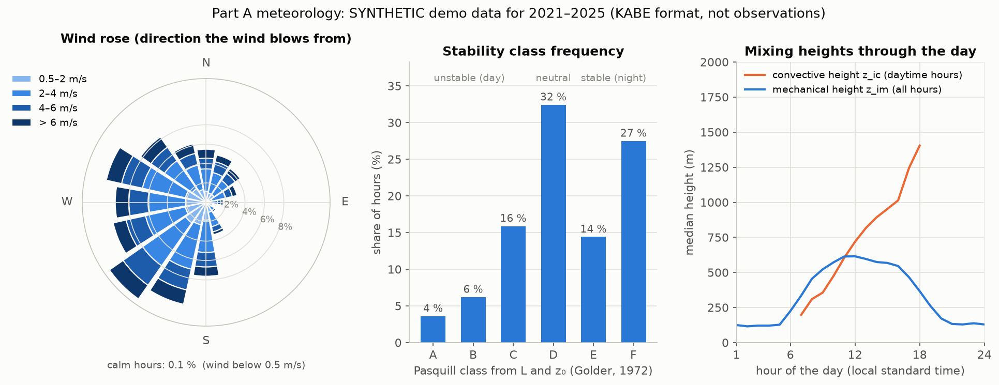

The synthetic year has westerly to south-westerly prevailing winds, as in the Lehigh Valley, a mean wind of 3.8 m/s and few calms (0.1 %), which is typical when 1-minute winds are used. Neutral hours (D) are the most common (32 %), followed by stable F nights (28 %). The convective mixing height grows from about 200 m after sunrise to about 1,400 m in the late afternoon.

### Design-Value Maps

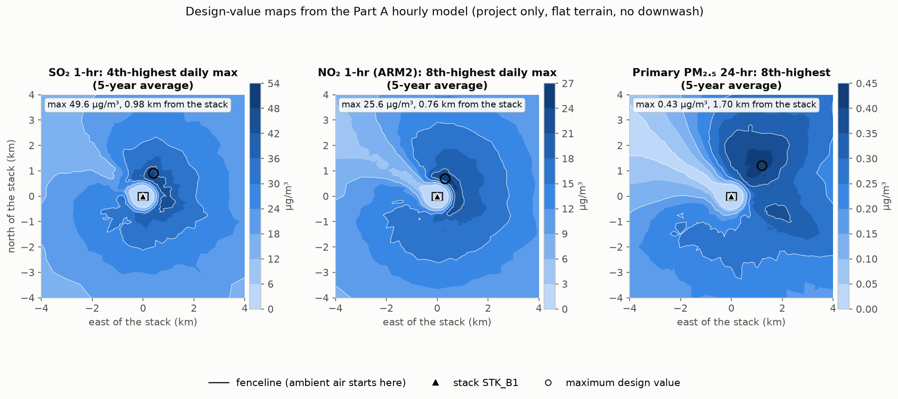

The highest 1-hour impacts fall 0.8–1.0 km from the stack, in unstable, light-wind hours when the buoyant plume is brought to the ground quickly. Close to the stack the concentrations are low because, in this model, the plume reaches its full rise immediately; without downwash nothing brings it down near the fence. The 24-hour PM₂.₅ maximum is farther out (1.7 km) and follows the prevailing winds to the north-east.

### Regulatory Comparison

| Test | Pollutant | Averaging time | Project (µg/m³) | Background | Total | Limit | Result |
| :--- | :--- | :--- | ---: | ---: | ---: | ---: | :--- |
| SIL | SO₂ | 1-hour | 66.1 | – | 66.1 | 7.8 | **above** |
| SIL | SO₂ | 3-hour | 51.0 | – | 51.0 | 25 | **above** |
| SIL | SO₂ | 24-hour | 13.2 | – | 13.2 | 5 | **above** |
| SIL | SO₂ | annual | 1.003 | – | 1.003 | 1 | **above** (by 0.3 %) |
| SIL | NO₂ | 1-hour | 39.7 | – | 39.7 | 7.5 | **above** |
| SIL | NO₂ | annual | 0.60 | – | 0.60 | 1 | below |
| SIL | PM₂.₅ | 24-hour | 7.79 (0.72 + 7.06 secondary) | – | 7.79 | 1.2 | **above** |
| SIL | PM₂.₅ | annual | 0.342 (0.070 + 0.272 secondary) | – | 0.342 | 0.13 | **above** |
| NAAQS | SO₂ | 1-hour | 49.6 | 13.1 | 62.7 | 196.4 | below (32 %) |
| NAAQS | SO₂ | 3-hour | 39.2 | 13.1 | 52.3 | 1,300 | below (4 %) |
| NAAQS | SO₂ | annual | 0.83 | 2.6 | 3.45 | 26.2 | below (13 %) |
| NAAQS | NO₂ | 1-hour | 25.6 | 75.3 | 100.9 | 188 | below (54 %) |
| NAAQS | NO₂ | annual | 0.60 | 18.8 | 19.4 | 100 | below (19 %) |
| NAAQS | PM₂.₅ | 24-hour | 7.50 | 20.0 | 27.5 | 35 | below (79 %) |
| NAAQS | PM₂.₅ | annual | 0.342 | 8.0 | 8.34 | 9.0 | below (93 %) |
| Class II increment | SO₂ | 3-hour | 39.2 | – | 39.2 | 512 | below (8 %) |
| Class II increment | SO₂ | 24-hour | 8.99 | – | 8.99 | 91 | below (10 %) |
| Class II increment | SO₂ | annual | 1.00 | – | 1.00 | 20 | below (5 %) |
| Class II increment | NO₂ | annual | 0.60 | – | 0.60 | 25 | below (2 %) |
| Class II increment | PM₂.₅ | 24-hour | 7.82 | – | 7.82 | 9 | below (87 %) |
| Class II increment | PM₂.₅ | annual | 0.357 | – | 0.357 | 4 | below (9 %) |

The background values are **illustrative** (5 ppb SO₂, 40 ppb and 10 ppb NO₂, 20 and 8.0 µg/m³ PM₂.₅), not monitor data; there are no nearby sources in this demonstration.

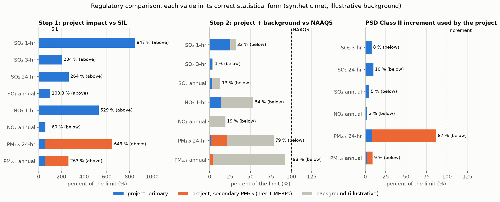

* **Step 1:** the project is significant for every averaging time except annual NO₂, so the cumulative analysis is required. The SO₂ annual value is above its SIL by only 0.3 %, at two receptors.
* **Step 2:** with the illustrative background, every total stays below its standard. The tightest are annual PM₂.₅ (93 %, almost all background, since the 2024 standard is close to typical background levels) and 24-hour PM₂.₅ (79 %).
* **PM₂.₅ is driven by secondary particles.** The primary PM₂.₅ impact (0.72 µg/m³ 24-hour, 0.070 µg/m³ annual) is below both SILs; the SIL is exceeded only because of the Tier 1 secondary estimate from about 1,650 tpy of SO₂ and NOx. That estimate uses the most conservative hypothetical sources in EPA's 2019 MERPs guidance, so it is an upper bound; it also takes 87 % of the 24-hour Class II increment. The natural next step would be the MERPs hypothetical sources for the Northeast, or Tier 2 photochemical modeling.

### Significant Impact Area

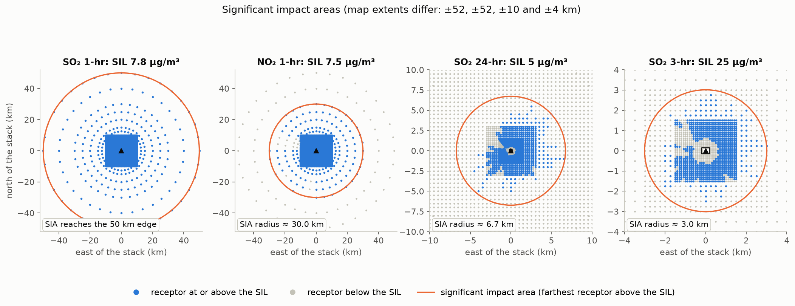

| Pollutant and averaging time | SIA radius |
| :--- | :--- |
| SO₂ 1-hour | reaches the 50 km edge of the receptor network |
| NO₂ 1-hour | 30 km |
| SO₂ 24-hour | 6.7 km |
| SO₂ 3-hour | 3.0 km |
| SO₂ annual | 2.1 km (two receptors) |
| PM₂.₅ | the whole domain, because the secondary estimate is a single value added everywhere |

The 1-hour SIAs are large because the SIL test uses the single highest day of each year at each receptor. At 40–50 km, that value comes from a few stable, light-wind hours in which the model carries the plume, barely diluted, in a straight line for 50 km, a trip that takes several hours. A steady-state model assumes the wind of one hour holds over the whole path, which is least realistic at these distances. This is a known limitation of all steady-state plume models, AERMOD included. For a real application, the SIA is capped at 50 km and the cumulative analysis would cover that area.

### NO₂ Tiers

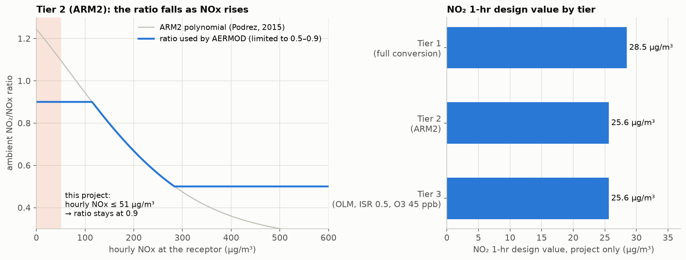

The hourly NOx at the receptors never exceeds about 51 µg/m³, far below the 115 µg/m³ where the ARM2 ratio starts to fall, so ARM2 applies its maximum ratio, 0.9, everywhere. OLM gives the same result: 45 ppb of ozone could convert all the NO, so the 0.9 equilibrium limit applies. For a tall, buoyant stack, the Tier 2 and Tier 3 refinements therefore change the 1-hour NO₂ design value only by 10 % (28.5 → 25.6 µg/m³). They matter far more for low sources with high near-field NOx.

### GEP Stack Height Sensitivity

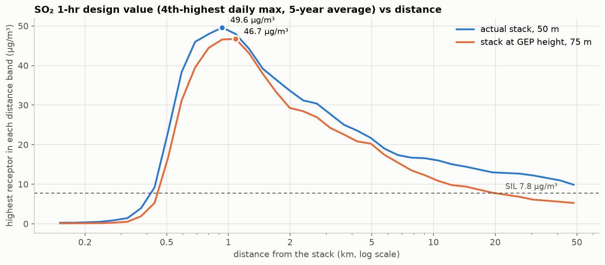

Raising the stack from 50 m to the 75 m GEP height lowers the maximum 1-hour SO₂ design value by only 6 % (49.6 → 46.7 µg/m³), because the 60–300 m of plume rise dominates the effective height. Part A has no building downwash and no terrain, however. With AERMOD in Part B, the GEP stack lowers the 1-hour SO₂ design value by about 18 % (2,400 → 1,980 µg/m³), still far above the standard, because the nearby ridge is higher than even a 75 m stack.

### The Plume in 3D

The three figures show the plume of each pollutant in the worst single hour of the five years. The ground shows the downwind and crosswind distance from the stack, the vertical axis is the height above the ground (starting at 0 m), and the colour is the concentration: light blue for low values, dark blue for high values. The concentration in the air is drawn as a cloud of points, and the concentration at ground level, the one that is compared with the standards, as filled contours on the ground. The colour scale is logarithmic, because the concentration falls by more than a hundred times from the core of the plume to its edges.

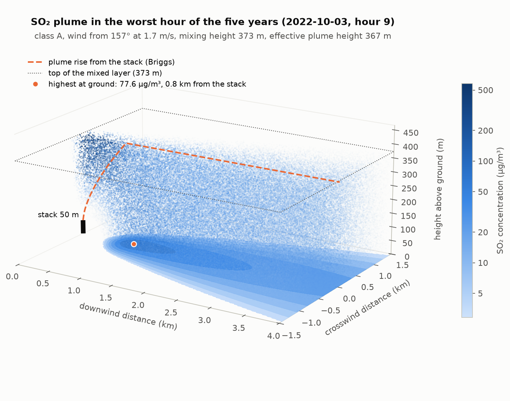

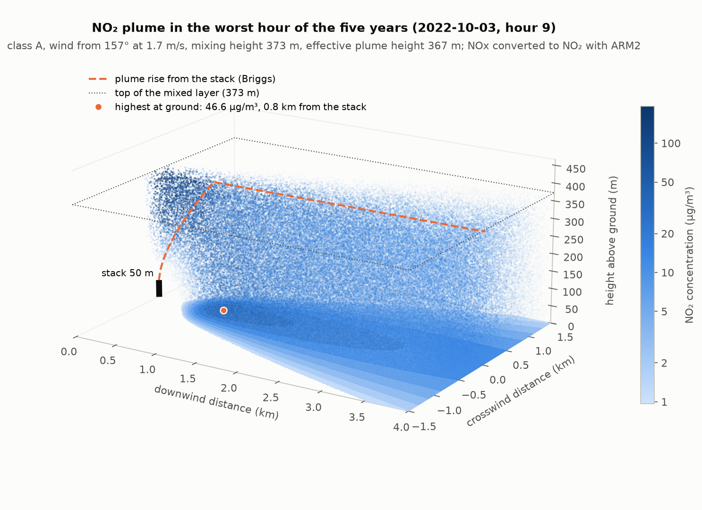

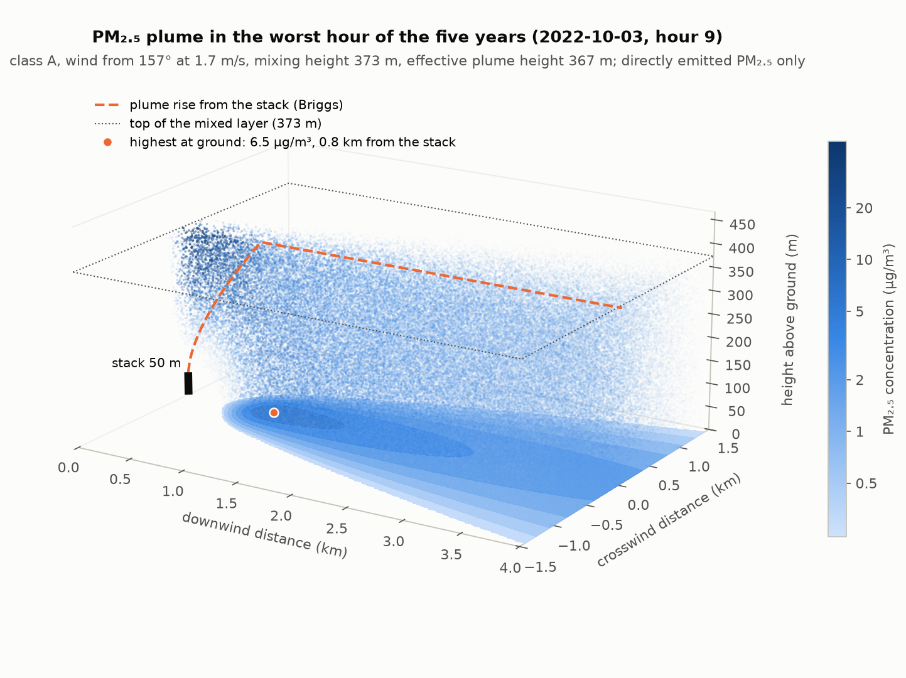

How to read them:

* **The worst hour** (3 October 2022, 08:00–09:00) is a class A morning with a light wind of 1.7 m/s. The plume rises from the 50 m stack to 367 m (orange dashed line), just below the top of the mixed layer at 373 m (dotted rectangle). The lid stops the plume from rising further and reflects it back down, so strong convection mixes it through the whole layer and brings it to the ground about 0.8 km from the stack.
* **The same plume, three pollutants.** All three pollutants leave the same stack in the same weather, so the plume has the same shape in every figure; only the amount changes with the emission rate (SO₂ 28.5, NOx 19.0 and PM₂.₅ 2.4 g/s). The highest ground-level value is 77.6 µg/m³ for SO₂, 46.6 µg/m³ for NO₂ and 6.5 µg/m³ for PM₂.₅ (on the fine grid of the figure; about 76 µg/m³ for SO₂ at the nearest receptor).
* **NO₂** is drawn after the ARM2 conversion of the NOx plume (Tier 2). At ground level the NOx stays below 115 µg/m³, so ARM2 uses its maximum ratio of 0.9 there. In the dense core aloft, where NOx reaches a few hundred µg/m³, the ratio falls towards 0.5, so the NO₂ core is weaker relative to the ground than the SO₂ core is.
* **PM₂.₅** shows only the directly emitted particles. Secondary PM₂.₅ forms from SO₂ and NOx over hours and far downwind, so it is not part of a one-hour plume; it is added separately with the MERPs estimate.
* **The dark core near the stack** sits at 367 m from the first metre: like ISCST3, the model uses the final plume rise at every distance, while the orange line shows how the plume really rises over the first 0.6 km (Briggs 2/3 law). The concentrations close to the stack are therefore drawn higher in the air than they are, but this does not change the ground-level values beyond about 0.6 km, where the maximum is.
* **The plume and the lid.** One more metre of plume rise would have put the plume above the lid and, in this model, made the ground-level concentration zero: in 2.8 % of the A–D hours (10 % of class A hours) the plume is above the lid and contributes nothing. AERMOD's penetrated-plume treatment removes this on/off jump.

## Results (Part B): AERMOD with Real Data

I ran the full EPA chain on 26–27 November 2026. The details, the data checks and the problems I fixed on the way are in [RESULTS_AERMOD.md](RESULTS_AERMOD.md); this section gives the main results.

### Meteorology and Data Checks

* **Surface:** Allentown KABE, GHCNh hourly data for 2021–2025 (43,824 hours): 1,044 calm hours (2.4 %) and 566 missing hours (1.3 %). Every quarter is at least 94 % complete; EPA asks for 90 %.
* **1-minute winds:** AERMINUTE read 57 of the 60 months (three are not in the NCEI archive); the 1-minute winds cover 86 % of the hours. The anemometer is 7.9 m (26 ft) above the ground.
* **Upper air:** Albany, NY has a morning (12Z) sounding on 1,360 of the 1,826 days; most gaps fall between December 2022 and October 2023. AERMET filled them with the Sterling, VA sounding (455 days) or a sounding from the day before or after (5 days); only 4 days (2–5 April 2022) have none.
* **Surface characteristics:** AERSURFACE with NLCD 2021 around the airport; 2021–2024 are years of average surface moisture and 2025 a dry year.
* **Terrain:** AERMAP with four USGS 3DEP 1 arc-second tiles puts the stack base at 128 m and the ridge south-east of the plant at 230–260 m.

### Regulatory Tests with AERMOD

Same standards, illustrative backgrounds and secondary PM₂.₅ estimate as Part A; the last column is the distance of the highest receptor from the stack.

| Test | Pollutant | Averaging time | Project (µg/m³) | Background | Total | Limit | Result | Where (km) |
| :--- | :--- | :--- | ---: | ---: | ---: | ---: | :--- | ---: |
| SIL | SO₂ | 1-hour | 2,550 | – | 2,550 | 7.8 | **above** | 0.42 |
| SIL | SO₂ | 3-hour | 1,760 | – | 1,760 | 25 | **above** | 0.54 |
| SIL | SO₂ | 24-hour | 426 | – | 426 | 5 | **above** | 0.42 |
| SIL | SO₂ | annual | 33.7 | – | 33.7 | 1 | **above** | 0.45 |
| SIL | NO₂ | 1-hour | 849 | – | 849 | 7.5 | **above** | 0.42 |
| SIL | NO₂ | annual | 13.2 | – | 13.2 | 1 | **above** | 0.45 |
| SIL | PM₂.₅ | 24-hour | 30.6 | – | 30.6 | 1.2 | **above** | 0.45 |
| SIL | PM₂.₅ | annual | 2.43 | – | 2.43 | 0.13 | **above** | 0.45 |
| NAAQS | SO₂ | 1-hour | 2,400 | 13.1 | 2,410 | 196.4 | **above** | 0.45 |
| NAAQS | SO₂ | 3-hour | 1,470 | 13.1 | 1,480 | 1,300 | **above** | 0.54 |
| NAAQS | SO₂ | annual | 25.6 | 2.6 | 28.2 | 26.2 | **above** | 0.45 |
| NAAQS | NO₂ | 1-hour | 758 | 75.3 | 833 | 188 | **above** | 0.45 |
| NAAQS | NO₂ | annual | 13.2 | 18.8 | 32.0 | 100 | below | 0.45 |
| NAAQS | PM₂.₅ | 24-hour | 19.4 | 20.0 | 39.4 | 35 | **above** | 0.45 |
| NAAQS | PM₂.₅ | annual | 2.43 | 8.0 | 10.4 | 9.0 | **above** | 0.45 |
| Class II increment | SO₂ | 3-hour | 1,470 | – | 1,470 | 512 | **above** | 0.54 |
| Class II increment | SO₂ | 24-hour | 302 | – | 302 | 91 | **above** | 0.45 |
| Class II increment | SO₂ | annual | 33.7 | – | 33.7 | 20 | **above** | 0.45 |
| Class II increment | NO₂ | annual | 13.2 | – | 13.2 | 25 | below | 0.45 |
| Class II increment | PM₂.₅ | 24-hour | 32.5 | – | 32.5 | 9 | **above** | 0.45 |
| Class II increment | PM₂.₅ | annual | 3.11 | – | 3.11 | 4 | below | 0.45 |

The PM₂.₅ rows include the Tier 1 secondary estimate (7.06 µg/m³ for 24 hours, 0.27 µg/m³ for the year). With OLM (Tier 3, constant 45 ppb of ozone) instead of ARM2, the 1-hour NO₂ design value is 842 µg/m³. The values match AERMOD's own summary tables in the `.out` files.

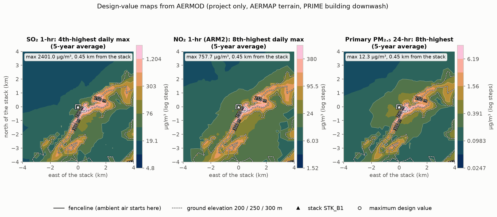

The high values follow the ridge south-east and north-east of the site (dashed lines: ground at 200, 250 and 300 m). The colour scale is *batlow* (Crameri, 2018), in logarithmic steps.

### AERMOD Against Part A

`compare_with_aermod.py` runs the Part A model on the same AERMET file and compares the two models at the same 3,225 receptors (primary impacts only):

| Design value | Part A max (µg/m³) | AERMOD max (µg/m³) | Part A / AERMOD | Receptors within a factor of 2 |
| :--- | ---: | ---: | ---: | ---: |
| SO₂ 1-hour (NAAQS form) | 61.1 | 2,400 | 0.03 | 71 % |
| SO₂ 24-hour (H1H) | 15.7 | 426 | 0.04 | 61 % |
| SO₂ annual (highest year) | 0.908 | 33.7 | 0.03 | 73 % |
| NO₂ 1-hour (NAAQS form, ARM2) | 31.3 | 758 | 0.04 | 67 % |
| PM₂.₅ 24-hour (NAAQS form) | 0.481 | 12.3 | 0.04 | 63 % |
| PM₂.₅ annual (5-year mean) | 0.067 | 2.16 | 0.03 | 73 % |

All 16 design values, with the fractional bias $FB = 2(A - B)/(A + B)$ and the correlation (Chang & Hanna, 2004), are in `08_Python_Analysis/part_a_results/aermet/comparison_with_aermod.md`. The two models disagree strongly on the maximum but agree within a factor of 2 at most receptors; the disagreement is on the high ground (right panel).

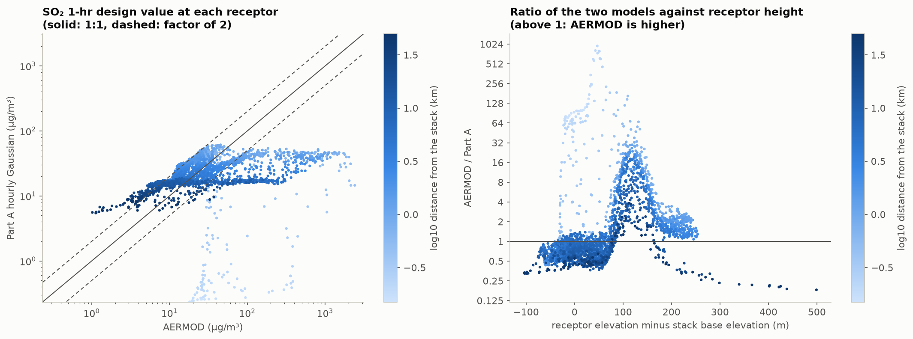

### Why AERMOD Is Higher: Terrain, Not Downwash

To find the cause, I ran AERMOD again for the three short-term design values with building downwash switched off, terrain switched off (`MODELOPT FLAT`), and both. Part A has neither, so these runs separate the effect of each.

| Set-up | SO₂ 1-hour | NO₂ 1-hour | PM₂.₅ 24-hour |
| :--- | ---: | ---: | ---: |
| Part A (no downwash, flat ground) | 61.1 | 31.3 | 0.481 |
| AERMOD regulatory run (downwash + terrain) | 2,400 | 758 | 12.3 |
| AERMOD, downwash, flat ground | 65.6 | 35.1 | 0.883 |
| AERMOD, no downwash, terrain | 2,580 | 800 | 14.4 |
| AERMOD, no downwash, flat ground | 46.0 | 25.4 | 0.832 |
| AERMOD regulatory run with the stack at its 75 m GEP height | 1,980 | – | – |

Highest design value at any receptor, µg/m³. The full tables, with where each maximum occurs, are in `08_Python_Analysis/part_a_results/aermet/comparison_diagnostics.md`.

The graphs show the highest design value in each distance band. Colour shows building downwash (orange: on, green: off), the line shows the ground (solid: with terrain, dashed: flat), and Part A is blue.


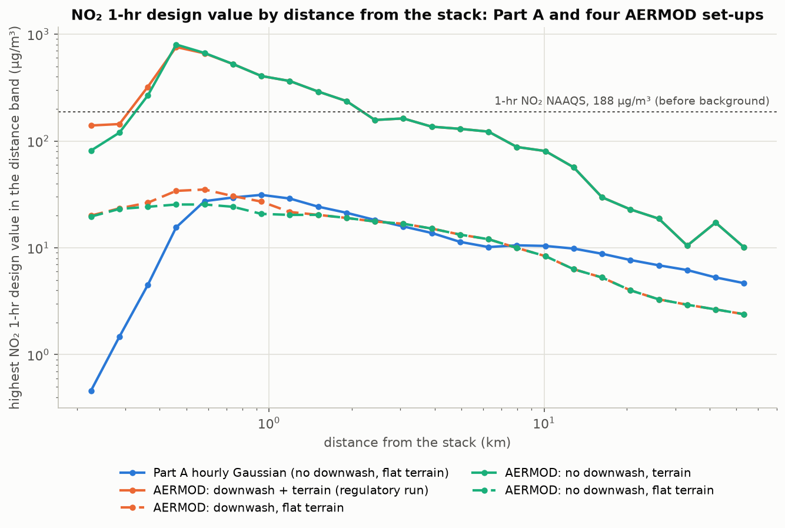

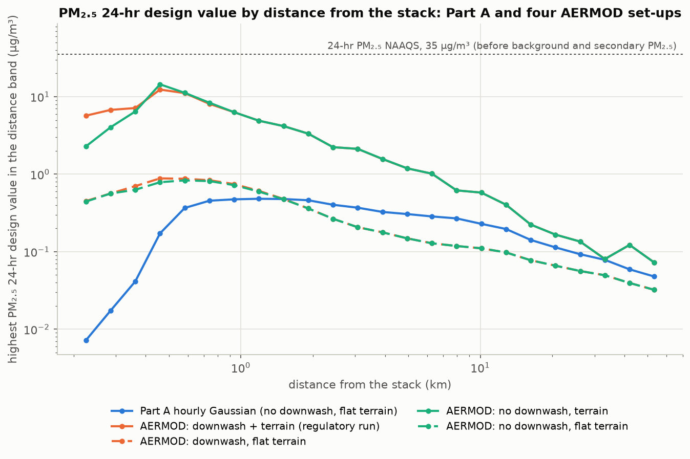

The same five set-ups as maps, with the same colour steps for a pollutant in every set of maps, so a colour means the same concentration everywhere:

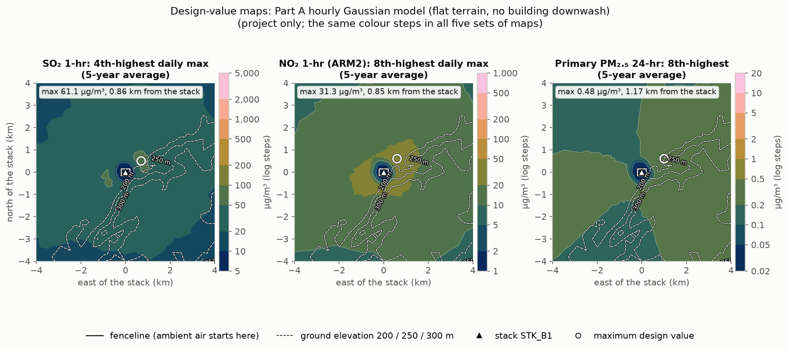

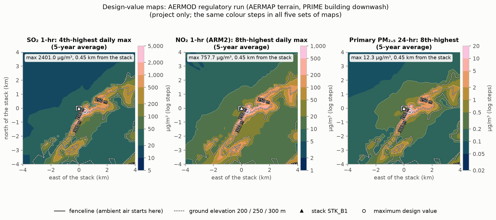

<details>
<summary>The three AERMOD test set-ups (click to open)</summary>

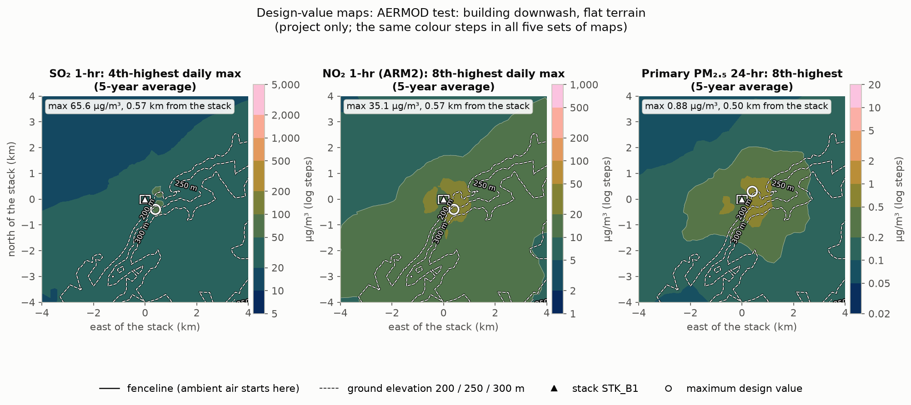

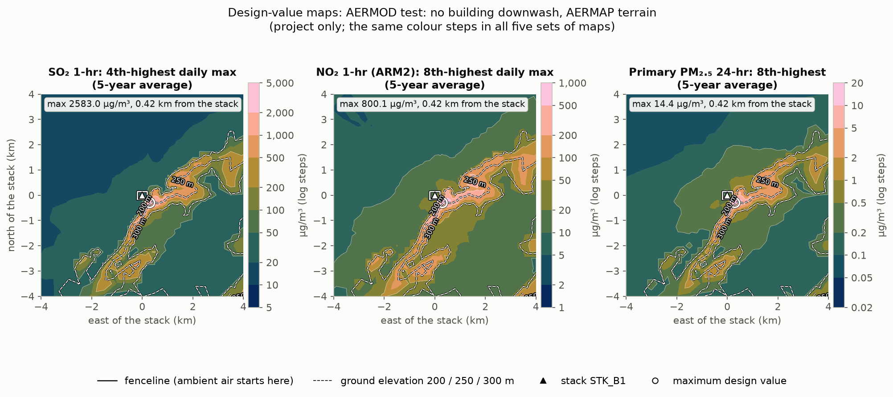

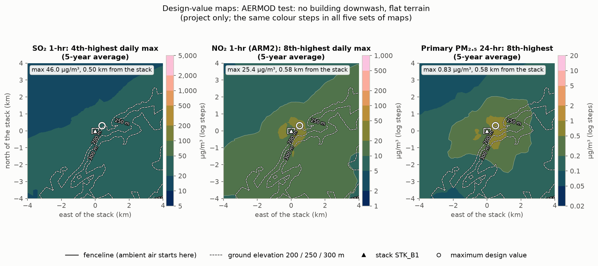

</details>

What the test runs show:

* **The three pollutants tell the same story.** They leave the same stack in the same weather, so the patterns are the same and only the size of the numbers changes.
* **On flat ground, the two models agree.** Without terrain, AERMOD's turbulence-based dispersion and Part A's Pasquill–Gifford curves end up within about a factor of 2 for this tall, buoyant stack.
* **Building downwash matters only near the fence.** Within about 0.4 km it raises the values by up to about 2.5 times; it does not change the maximum, which is set by the hill.
* **The hill causes the big numbers.** In stable air the plume stays at about the same height above sea level, and the ground 0.4–0.6 km away is about as high as the plume. Air below AERMOD's dividing-streamline height $H_c$ cannot rise over the hill, so in stable hours much of the plume runs into the hillside, little diluted. Part A assumes flat ground, so it cannot see this.
* **A GEP stack does not solve it.** The ridge is higher than even a 75 m stack, so the 1-hour SO₂ value drops only by about 18 %.

### What This Means for the Permit

With AERMOD, the regulatory model, Unit B1 as designed cannot be permitted at this site. To meet the 1-hour SO₂ NAAQS, the project's own design value must stay below 196.4 − 13.1 = 183 µg/m³; AERMOD gives 2,400 µg/m³, so SO₂ emissions would have to fall by about 92 % (for example with a scrubber), and the 1-hour NO₂ and 24-hour PM₂.₅ results would need large cuts too. The options are much lower emissions, moving the stack away from the ridge, or both.

Part A could not find this problem, because its flat-terrain, no-downwash physics leaves out exactly the effect that controls this site. That is the main lesson of the comparison: a screening-style Gaussian model is useful for understanding the method, but a site next to high ground needs AERMOD's terrain treatment.

## What I Corrected from the First Version

The first version of this kit had the right workflow and the right averaging-time forms for SO₂ and NO₂, but its results did not come from AERMOD and several inputs would not run with the current EPA programs.

| Item | First version | This version |
| :--- | :--- | :--- |
| Figures | computed with one Gaussian formula (class B for every hour, plume rise capped at 45 m), not with AERMOD or hourly weather | hourly model over 5 years; every design value in its correct form |
| Met file | `APEX_2018_2022.SFC`: synthetic, one year only, no relative humidity column, constant pressure and cloud | documented synthetic 5-year file in AERMET format (Part A); real data through AERMET in Part B |
| Met period and data | 2018–2022; FSL upper air (no longer available); ISHD surface data (retired by NCEI) | 2021–2025; IGRA upper air; GHCNh surface data (AERMET 26135) |
| AERMET | three stages with the obsolete `MERGE` stage; no `ADJ_U*`, `THRESH_1MIN`, `SUB_CC`, `SUB_TT`, `UASELECT`; upper-air station without the required elevation | two stages with the recommended options |
| AERSURFACE | `ARID_NO`, legacy `AP` flag, NLCD 2011, one moisture case | `NONARID`, `VARYZ0`/`LOWZ0`, NLCD 2021, three moisture runs assigned to years |
| AERMINUTE | wrong `IFWGROUP` syntax, partial file list | correct syntax, every available month (57 of 60) |
| Receptors | overlapping grids, no fenceline, ±10 km | fenceline, nested grids and polar rings to 50 km, written by code for AERMAP and Part A alike |
| AERMOD | `SITEDATA` without on-site data; `NO2STACK` on the SO pathway; PVMRM with an unjustified in-stack ratio of 0.10; no PM₂.₅ runs; increments from a multi-year run | removed; ARM2 (Tier 2); PM₂.₅ runs; one run per year for H1H/H2H; optional OLM with the correct keywords |
| AERSCREEN | hand-written restart file that AERSCREEN cannot read | the prompt answers (AERSCREEN writes its own `aerscreen.inp`) |
| Limits | PM₂.₅ annual NAAQS 12 and SIL 0.3 µg/m³; Class I and III increments compared at near-field receptors | current values; Class II increments at the receptors, Class I through the Federal Land Managers |
| README | mentioned a Martins Creek benchmark and a ±50 % AERSURFACE sensitivity that the code did not contain | describes only what the code does |

## How to Run

### Part A only (any computer with Python)

Part A needs Python 3.9 or newer with `numpy` and `matplotlib`, and no downloads:

```
pip install -r requirements.txt
cd 08_Python_Analysis
python run_part_a.py            # model, design values, tables and figures (about 1 minute)
python make_illustrations.py    # the concept illustrations
```

The tables go to `08_Python_Analysis/part_a_results/demo/` and the figures to `images/part_a/`.

### Part B: the full EPA chain (Windows)

The EPA programs run on Windows. Double-click these files in order, and wait until a window says it has finished before starting the next one. Never run two steps at the same time: two AERMAP runs, for example, write the same temporary files and crash each other.

| Step | File | What it does | Time |
| :--- | :--- | :--- | :--- |
| A | `A_download_data.bat` | downloads the EPA programs and all data into `Bin/` and `data/` (files already there are skipped; see [data/README.md](data/README.md)) | depends on the connection (about 600 MB) |
| B | `B_run_preprocessors.bat` | prepares the data, then runs AERSURFACE, AERMINUTE, AERMET, AERMAP and BPIPPRM | about 40 minutes, most of it AERMAP |
| C | `C_run_aermod.bat` | the 19 regulatory AERMOD runs, 6 at a time | about 12 minutes |
| D | `D_run_test_runs.bat` (optional) | the 10 test runs with downwash or terrain switched off, and the GEP stack | about 15 minutes |
| E | `E_make_figures.bat` | Python: concept illustrations, Part A, the AERMOD tables, the comparison and every figure | about 3 minutes |

Every step writes a log in `logs/`. Step B can run single programs: `B_run_preprocessors.bat B4` reruns only AERMET (B1 data preparation, B2 AERSURFACE, B3 AERMINUTE, B4 AERMET, B5 AERMAP, B6 BPIPPRM). All EPA input files are written by `make_epa_inputs.py` from `project_setup.py`; after changing the project (for example the emission rates), run `python make_epa_inputs.py` in `08_Python_Analysis` and then steps B to E again.

### Scripts

| Script | What it does |
| :--- | :--- |
| `08_Python_Analysis/project_setup.py` | every input of the case study: source, building, fence, receptors, emissions, stations, standards, background |
| `08_Python_Analysis/make_demo_met.py` | writes the synthetic 2021–2025 met files (AERMET format) |
| `08_Python_Analysis/hourly_gaussian_model.py` | the Part A model (Steps 1–7), including the 3D concentration used in the plume figures |
| `08_Python_Analysis/run_part_a.py` | runs Part A, builds the design values and the regulatory tests, writes `part_a_results/` |
| `08_Python_Analysis/part_a_figures.py` | the result figures (Part A, AERMOD maps, comparison maps) |
| `08_Python_Analysis/make_illustrations.py` | the concept illustrations |
| `08_Python_Analysis/make_epa_inputs.py` | writes every Part B input file (AERSURFACE to AERMOD, including the test runs) |
| `08_Python_Analysis/extract_bpip_lines.py` | turns the BPIPPRM output into an AERMOD include file |
| `08_Python_Analysis/aermod_results.py` | AERMOD design values and regulatory tests (`part_b_results/`) |
| `08_Python_Analysis/compare_with_aermod.py` | Part A against AERMOD, the test runs, the distance graphs and the maps of all set-ups |
| `tools/download_data.ps1` | step A |
| `tools/prepare_data.py`, `tools/run_preprocessors.ps1` | step B |
| `tools/run_aermod.ps1` | steps C and D (several AERMOD runs at a time, below-normal priority) |

### Folder Structure

```
AERMOD-NSR-PSD-Permit-Modeling/
├── README.md                    this article
├── RESULTS_AERMOD.md            Part B report: data checks, results, comparison, fixes
├── requirements.txt             Python packages
├── A_download_data.bat          step A: EPA programs and data
├── B_run_preprocessors.bat      step B: AERSURFACE, AERMINUTE, AERMET, AERMAP, BPIPPRM
├── C_run_aermod.bat             step C: the 19 AERMOD runs
├── D_run_test_runs.bat          step D: the 10 test runs (optional)
├── E_make_figures.bat           step E: tables and figures
├── 01_AERSURFACE/               3 control files (average, wet, dry) and outputs
├── 02_AERMINUTE/                aerminute.inp and the hourly 1-minute winds summary
├── 03_AERMET/                   stage 1 and stage 2 inputs, reports, KABE_2021_2025.SFC/.PFL
├── 04_AERMAP/                   aermap.inp, 3,225 receptors with elevations
├── 05_BPIPPRM/                  building input, output and the AERMOD include file
├── 06_AERMOD/                   naaqs_sil/, per_year/, optional/, diagnostic/ (inputs and reports)
│   └── output/                  PLOTFILEs and summary files of every run
├── 07_AERSCREEN/                optional screening run: the prompt answers
├── 08_Python_Analysis/          Part A model and demo met, results, Part B tables and comparison
├── data/README.md               the data step A downloads (the data are not on GitHub)
├── images/
│   ├── concepts/                concept illustrations
│   ├── part_a/                  Part A results (synthetic weather), including the 3D plumes
│   ├── aermod/                  AERMOD design-value maps
│   └── comparison/              Part A against AERMOD, distance graphs, maps/ of all set-ups
└── tools/                       the scripts behind steps A to D
```

`Bin/` (EPA programs), `data/` (downloaded data), `logs/` and a few large intermediate files are not on GitHub (see `.gitignore`); steps A and B create them again.

## Limitations and Further Work

### Limitations

* **Synthetic meteorology in the first Part A run:** those numbers show the method; the real-weather results are the Part B ones.
* **Part A has flat terrain, no building downwash and rural dispersion only**, and leaves out exactly the effect that controls this site.
* **Pasquill–Gifford curves** come from releases near the ground over flat land and are most reliable within about 10 km; the hour-by-hour steady-state assumption is weakest at the 30–50 km edge of the SIA, for AERMOD as well.
* **ISC-style mixing lid in Part A:** the plume is either fully below or fully above the lid, with no partial penetration.
* **Background and nearby sources:** the background is illustrative and no nearby sources are included.
* **Secondary PM₂.₅:** the Tier 1 estimate uses the most conservative hypothetical sources, not the ones that best represent this region.
* **Emissions:** constant at the maximum rate every hour of every year.

### Further Work

* Redesign the project and model it again: lower SO₂, NOx and PM₂.₅ emissions (scrubber, SCR, better particle control), or a stack location away from the ridge.
* Replace the illustrative background with monitor design values (EPA, 2024) and build the nearby-source inventory for the SIA.
* Refine the secondary PM₂.₅ estimate with the MERPs hypothetical sources for the Northeast, and consult the Federal Land Managers about the Brigantine Class I area.
* Use the actual in-stack NO₂/NOx ratio and hourly ozone if Tier 3 is needed.
* Run the AERSCREEN screening step (`07_AERSCREEN/`) as a check.

## References

### Regulations and EPA guidance

* 40 CFR Part 50, National Primary and Secondary Ambient Air Quality Standards; 40 CFR 50.1(e), definition of ambient air.
* 40 CFR 51.100(ii), definition of good engineering practice stack height; 40 CFR 51.165(b)(2), significance levels; 40 CFR 52.21, Prevention of Significant Deterioration of air quality.
* 40 CFR Part 51, Appendix W, *Guideline on Air Quality Models*, as revised in 89 FR 95034 (November 29, 2024).
* U.S. EPA (2024). *Reconsideration of the National Ambient Air Quality Standards for Particulate Matter*, 89 FR 16202 (March 6, 2024).
* U.S. EPA (2024). *Review of the Secondary National Ambient Air Quality Standards for Oxides of Nitrogen, Oxides of Sulfur, and Particulate Matter*, final decision, 89 FR 105692 (December 27, 2024).
* U.S. EPA. *Alternative Demonstration Approach for the 2024 Secondary Sulfur Dioxide NAAQS under the PSD Program*, and *Alternative Demonstration Approach for the 1971 Secondary 3-Hour Sulfur Dioxide NAAQS under the PSD Program* (October 10, 2025).
* U.S. EPA (2010). *Applicability of Appendix W Modeling Guidance for the 1-hour NO₂ NAAQS* (June 28) and *for the 1-hour SO₂ NAAQS* (August 23); *General Guidance for Implementing the 1-hour NO₂ NAAQS in PSD Permits, Including an Interim 1-hour NO₂ SIL* (June 29); *Guidance Concerning the Implementation of the 1-hour SO₂ NAAQS for the PSD Program* (August 23).
* U.S. EPA (2011). *Additional Clarification Regarding Application of Appendix W Modeling Guidance for the 1-hour NO₂ NAAQS* (March 1).
* U.S. EPA (2013). *Use of ASOS Meteorological Data in AERMOD Dispersion Modeling* (March 8).
* U.S. EPA (2018). *Guidance on Significant Impact Levels for Ozone and Fine Particles in the PSD Permitting Program* (April 17), and its supplement for the 2024 PM₂.₅ NAAQS (April 30, 2024).
* U.S. EPA (2019). *Guidance on the Development of Modeled Emission Rates for Precursors (MERPs) as a Tier 1 Demonstration Tool for Ozone and PM₂.₅ under the PSD Permitting Program*, EPA-454/R-19-003, with the 2024 update memorandum.
* U.S. EPA (2019). *Revised Policy on Exclusions from "Ambient Air"* (December 2).
* U.S. EPA (2022). *Guidance for Ozone and Fine Particulate Matter Permit Modeling*, EPA-454/R-22-005.
* U.S. EPA (2024). *Guidance on Developing Background Concentrations for Use in Modeling Demonstrations*, EPA-454/R-24-003.
* FLAG (2010). *Federal Land Managers' Air Quality Related Values Work Group (FLAG) Phase I Report — Revised (2010)*. Natural Resource Report NPS/NRPC/NRR—2010/232.

### EPA model documentation

* U.S. EPA (2024). *AERMOD Model Formulation*, EPA-454/B-24-010; *User's Guide for the AMS/EPA Regulatory Model (AERMOD)*, EPA-454/B-24-007; *AERMOD Implementation Guide*, EPA-454/B-24-009; *AERMOD Quick Reference*.
* U.S. EPA (2026). *User's Guide for the AERMOD Meteorological Preprocessor (AERMET)*, version 26135.
* U.S. EPA (2026). *User's Guide for AERSURFACE Tool*, EPA-454/B-26-007.
* U.S. EPA (2024). *User's Guide for the AERMOD Terrain Preprocessor (AERMAP)*, EPA-454/B-24-008.
* U.S. EPA (2023). *AERMINUTE User's Guide*, EPA-454/B-23-007.
* U.S. EPA (2021). *AERSCREEN User's Guide*, EPA-454/B-21-005.
* U.S. EPA (1993). *User's Guide to the Building Profile Input Program*, EPA-454/R-93-038.
* U.S. EPA (1995). *User's Guide for the Industrial Source Complex (ISC3) Dispersion Models, Volume II: Description of Model Algorithms*, EPA-454/B-95-003b.
* U.S. EPA (2015). *Technical Support Document for NO₂-related AERMOD Modifications*, EPA-454/B-15-004.
* RTP Environmental Associates (2013). *Ambient Ratio Method Version 2 (ARM2) for use with AERMOD for 1-hr NO₂ Modeling: Development and Evaluation Report*.

### Textbooks

* Arya, S.P. (1999). *Air Pollution Meteorology and Dispersion*. Oxford University Press.
* De Visscher, A. (2014). *Air Dispersion Modeling: Foundations and Applications*. Wiley.
* Seinfeld, J.H., & Pandis, S.N. (2016). *Atmospheric Chemistry and Physics: From Air Pollution to Climate Change* (3rd ed.). Wiley.
* Stull, R.B. (1988). *An Introduction to Boundary Layer Meteorology*. Kluwer Academic.
* Turner, D.B. (1994). *Workbook of Atmospheric Dispersion Estimates: An Introduction to Dispersion Modeling* (2nd ed.). CRC Press.

### Papers

* Briggs, G.A. (1969). *Plume Rise*. USAEC Critical Review Series, TID-25075.
* Briggs, G.A. (1974). *Diffusion Estimation for Small Emissions*. ATDL Contribution File No. 79, NOAA.
* Briggs, G.A. (1975). Plume rise predictions. In *Lectures on Air Pollution and Environmental Impact Analyses*, American Meteorological Society, 59–111.
* Carson, D.J. (1973). The development of a dry inversion-capped convectively unstable boundary layer. *Quarterly Journal of the Royal Meteorological Society*, 99, 450–467.
* Chang, J.C., & Hanna, S.R. (2004). Air quality model performance evaluation. *Meteorology and Atmospheric Physics*, 87, 167–196.
* Cimorelli, A.J., et al. (2005). AERMOD: A dispersion model for industrial source applications. Part I: General model formulation and boundary layer characterization. *Journal of Applied Meteorology*, 44, 682–693.
* Golder, D. (1972). Relations among stability parameters in the surface layer. *Boundary-Layer Meteorology*, 3, 47–58.
* Holtslag, A.A.M., & van Ulden, A.P. (1983). A simple scheme for daytime estimates of the surface fluxes from routine weather data. *Journal of Climate and Applied Meteorology*, 22, 517–529.
* Paulson, C.A. (1970). The mathematical representation of wind speed and temperature profiles in the unstable atmospheric surface layer. *Journal of Applied Meteorology*, 9, 857–861.
* Perry, S.G., et al. (2005). AERMOD: A dispersion model for industrial source applications. Part II: Model performance against 17 field study databases. *Journal of Applied Meteorology*, 44, 694–708.
* Podrez, M. (2015). An update to the ambient ratio method for 1-h NO₂ air quality standards dispersion modeling. *Atmospheric Environment*, 103, 163–170.
* Qian, W., & Venkatram, A. (2011). Performance of steady-state dispersion models under low wind-speed conditions. *Boundary-Layer Meteorology*, 138, 475–491.
* Schulman, L.L., Strimaitis, D.G., & Scire, J.S. (2000). Development and evaluation of the PRIME plume rise and building downwash model. *Journal of the Air & Waste Management Association*, 50, 378–390.
* van Ulden, A.P., & Holtslag, A.A.M. (1985). Estimation of atmospheric boundary layer parameters for diffusion applications. *Journal of Climate and Applied Meteorology*, 24, 1196–1207.
* Venkatram, A. (1980). Estimating the Monin-Obukhov length in the stable boundary layer for dispersion calculations. *Boundary-Layer Meteorology*, 19, 481–485.
* Weil, J.C., & Brower, R.P. (1983). *Estimating Convective Boundary Layer Parameters for Diffusion Applications*. Maryland Power Plant Siting Program, PPSP-MP-48.

### Data (Part B)

* NOAA NCEI: Global Historical Climatology Network hourly (GHCNh); ASOS 1-minute data (DSI-6405); Integrated Global Radiosonde Archive, version 2.2 (Durre et al.); Global Summary of the Year.
* NWS: *ASOS Sites by Equipment* (March 18, 2025), for the anemometer height.
* MRLC: National Land Cover Database 2021 (land cover, impervious surface, tree canopy).
* USGS: 3D Elevation Program, 1 arc-second DEM.

### Python libraries and colour maps

* NumPy (Harris et al., 2020) and Matplotlib (Hunter, 2007).
* Crameri, F. (2018). *Scientific colour maps* (batlow). Zenodo, doi:10.5281/zenodo.1243862; Crameri, F., Shephard, G.E., & Heron, P.J. (2020). The misuse of colour in science communication. *Nature Communications*, 11, 5444.
