# Air Quality Permit Modeling for a New Major Source: An NSR/PSD Dispersion Analysis with AERMOD and an Hourly Gaussian Model

This project examines the air-quality analysis required for a Prevention of Significant Deterioration (PSD) permit for a new industrial stack in the United States. The case study is a hypothetical facility, *Apex Industrial Power & Steam, Unit B1*, located in eastern Pennsylvania near Martins Creek. The meteorological data come from Allentown Airport (KABE).

The work has two parts:

* **Part A – Python Gaussian plume model:** A Python model based on the ISCST3 formulation, which EPA used before AERMOD. It calculates hourly concentrations for five years of weather data (43,824 hours) at 3,225 receptors. The model then calculates the required design values and compares them with the significant impact levels (SILs), the National Ambient Air Quality Standards (NAAQS), and the PSD increments. It is first tested with a synthetic five-year meteorological file generated using AERMET's boundary-layer equations. It is then run again with the real AERMET data used in Part B.
* **Part B – EPA AERMOD modeling system:** The full regulatory modeling chain is run with real meteorological data from 2021 to 2025. This includes AERSURFACE, AERMINUTE, AERMET, AERMAP, BPIPPRM, and AERMOD. The input files use the same facility and emissions data as Part A. The Python model is also run with the same AERMET data so that its results can be compared with AERMOD at each receptor. Additional AERMOD runs switch terrain and building downwash on and off to identify the main causes of any differences.

The methods are based on EPA's *Guideline on Air Quality Models* (40 CFR Part 51, Appendix W), the AERMOD formulation and user's guides, EPA permit-modeling guidance, and standard textbooks on air-pollution meteorology and dispersion (Turner, 1994; Arya, 1999; De Visscher, 2014; Seinfeld & Pandis, 2016). The facility and its emissions are hypothetical and are used for demonstration. The standards, SILs, and PSD increments are the values in force in November 2026.

## Key Findings

* **The proposed facility does not meet the air-quality limits at this location.** The AERMOD results exceed the 1-hour SO₂ and NO₂ NAAQS, both PM₂.₅ NAAQS, both secondary SO₂ standards, and four Class II increments. Meeting the 1-hour SO₂ NAAQS would require an SO₂ reduction of about 92%, or a different site.
* **Nearby terrain drives the high concentrations.** A ridge lies 0.4–0.6 km south-east of the stack. Its surface is 100–130 m above the stack base, close to the plume's height. During stable conditions, AERMOD predicts that much of the plume reaches the hillside before it has dispersed. This increases the design values by a factor of 20–40.
* **The difference between the models is mainly their treatment of terrain.** When terrain is removed from AERMOD, its results are generally within a factor of two of the Part A model. Building downwash has a noticeable effect only within about 0.4 km of the stack.

| Design value (µg/m³, project only) | Limit | Part A model | AERMOD, flat ground | AERMOD, regulatory run (terrain + downwash) |
| :--- | ---: | ---: | ---: | ---: |
| SO₂ 1-hour (4th-highest daily max, 5-year average) | 196.4 | 61 | 46–66 | **2,400** |
| NO₂ 1-hour, ARM2 (8th-highest daily max, 5-year average) | 188 | 31 | 25–35 | **758** |
| Primary PM₂.₅ 24-hour (8th-highest, 5-year average) | 35 | 0.48 | 0.83–0.88 | **12.3** |

Each model uses the same 2021–2025 meteorological data and the same 3,225 receptors. The limits shown are the NAAQS; background concentrations have not yet been added.

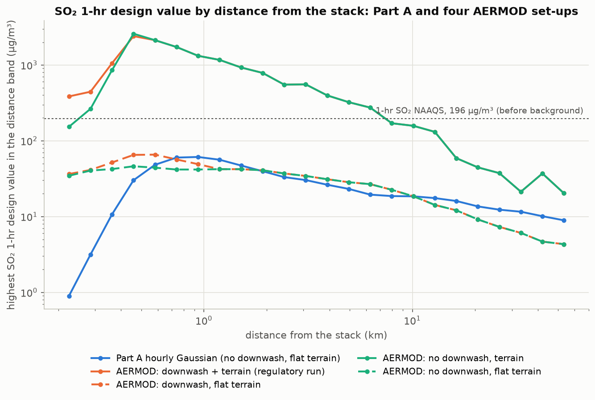

The full Part B report, including data checks and troubleshooting details, is available in [RESULTS_AERMOD.md](RESULTS_AERMOD.md).

The next sections introduce the regulatory and dispersion-modeling concepts used in the analysis.

## Basic Concepts and Terms

### Air Quality Standards and Design Values

Under the Clean Air Act, EPA sets **National Ambient Air Quality Standards (NAAQS)** for six common pollutants, known as *criteria pollutants*. Primary standards are designed to protect public health. Secondary standards protect public welfare, including vegetation, soil, water, and visibility.

A standard is defined by four elements:

* **Indicator:** the pollutant measured, e.g. SO₂, NO₂, PM₂.₅ (particles smaller than 2.5 µm).
* **Averaging time:** 1 hour, 24 hours, a year, and so on.
* **Level:** the concentration, in ppb or µg/m³.
* **Form:** the statistic compared with the level. The 1-hour SO₂ standard, for example, is not "never above 75 ppb"; it is the 99th percentile of the daily maximum 1-hour values, averaged over three years.

The resulting statistic is called the **design value**. It can be calculated from monitored concentrations or from modeled concentrations. In this project, the model calculates hourly concentrations at every receptor, and those hourly values are processed using the same statistical form that applies to monitoring data. The procedure is described in [Design Values in Modeling](#design-values-in-modeling).

| Pollutant | Averaging time | Level | Form |
| :--- | :--- | :--- | :--- |
| SO₂ | 1-hour (primary) | 75 ppb (196.4 µg/m³) | 99th percentile of the daily maximum 1-hour values, averaged over 3 years |
| SO₂ | 3-hour (secondary, 1971) | 0.5 ppm (1,300 µg/m³) | not to be exceeded more than once per year |
| SO₂ | annual (secondary, 2024) | 10 ppb (26.2 µg/m³) | annual mean, averaged over 3 years |
| NO₂ | 1-hour (primary) | 100 ppb (188 µg/m³) | 98th percentile of the daily maximum 1-hour values, averaged over 3 years |
| NO₂ | annual | 53 ppb (100 µg/m³) | annual mean |
| PM₂.₅ | 24-hour | 35 µg/m³ | 98th percentile, averaged over 3 years |
| PM₂.₅ | annual (primary, 2024) | 9.0 µg/m³ | annual mean, averaged over 3 years |

Gas concentrations convert between the two units at 25 °C and 1 atm:

$$
C\ [\mu\text{g/m}^3] = C\ [\text{ppb}] \times \frac{M}{24.45}
$$

where $M$ is the molecular weight (64.07 g/mol for SO₂, 46.01 for NO₂, 48.00 for O₃) and 24.45 L/mol is the molar volume of air.

Two recent regulatory changes affect this analysis. In 2024, EPA lowered the primary annual PM₂.₅ standard from 12.0 to 9.0 µg/m³ (89 FR 16202). In December 2024, EPA also established an annual secondary SO₂ standard of 10 ppb (89 FR 105692). The existing 3-hour secondary SO₂ standard from 1971 remains in effect.

EPA has issued alternative demonstration approaches that allow a PSD applicant to use the 1-hour primary SO₂ analysis to address both secondary SO₂ standards. However, the 3-hour SO₂ results are still needed to assess the PSD increment.

### New Source Review and PSD

**New Source Review (NSR)** is the Clean Air Act program that requires certain facilities to obtain an air permit before construction begins. A new **major stationary source** must obtain the appropriate permit:

* In an area that meets the NAAQS (attainment or unclassifiable), the permit is a **PSD** permit (40 CFR 52.21). In an area that violates a standard, it is a Nonattainment NSR permit.
* A source is major if its potential to emit any regulated pollutant is at least **100 tons per year** for 28 listed source categories, including fossil fuel-fired steam electric plants of more than 250 MMBtu/h heat input, or at least **250 tons per year** for all other sources.
* Each pollutant whose emissions increase reaches its **significant emission rate (SER)** is reviewed: 40 tpy for SO₂ and NOx, 10 tpy for direct PM₂.₅ (plus 40 tpy for SO₂ and NOx as PM₂.₅ precursors), 15 tpy for PM₁₀, 100 tpy for CO.

For each pollutant subject to review, the applicant must apply **Best Available Control Technology (BACT)**. The applicant must also use air-dispersion modeling to demonstrate that the proposed project will not cause or contribute to a violation of a NAAQS or a PSD increment. The figure below summarizes the two main modeling steps.

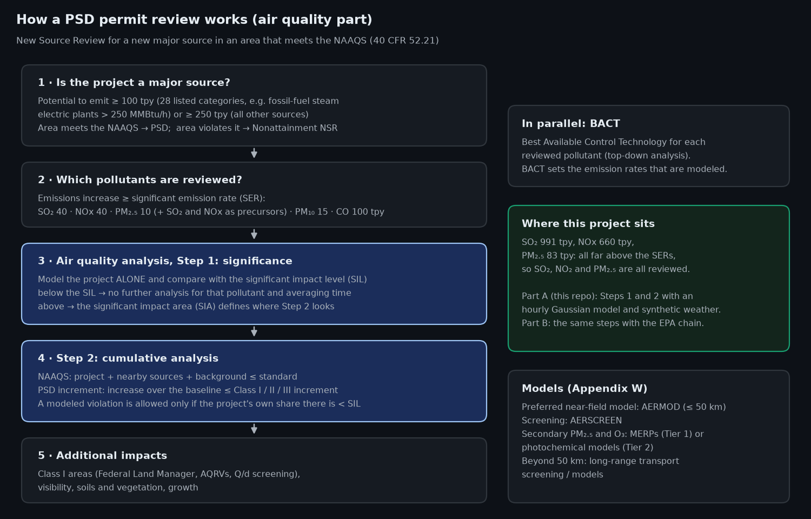

### Significant Impact Levels and the Cumulative Analysis

A **significant impact level (SIL)** is a concentration threshold used to decide whether a proposed source's impact is small enough to end the analysis for a pollutant and averaging period. If the modeled impact is below the applicable SIL, the project is generally considered not to cause or contribute to a violation for that pollutant and averaging period (EPA, 2018).

The analysis therefore begins by modeling the proposed project on its own:

1. **Significance analysis:** model only the new source and compare its highest impact with the SIL. If it is below, the analysis for that pollutant and averaging time ends.
2. **Cumulative analysis:** if it is above, the receptors where the project exceeds the SIL form the **significant impact area (SIA)**. There, the project is modeled together with **nearby sources** (other sources that could cause a significant concentration gradient in the SIA), and a **background concentration** from representative monitors is added. The total must be below the NAAQS. If a violation appears, the project is still acceptable when its own contribution at that receptor and time is below the SIL.

| Pollutant and averaging time | SIL (µg/m³) | Source |
| :--- | :---: | :--- |
| SO₂ 1-hour | 7.8 (3 ppb) | interim SIL, EPA memorandum (2010) |
| SO₂ 3-hour / 24-hour / annual | 25 / 5 / 1 | 40 CFR 51.165(b)(2) |
| NO₂ 1-hour | 7.5 (4 ppb) | interim SIL, EPA memorandum (2010) |
| NO₂ annual | 1 | 40 CFR 51.165(b)(2) |
| PM₂.₅ 24-hour / annual | 1.2 / 0.13 | EPA SIL guidance (2018) and its 2024 supplement for the 9.0 µg/m³ standard |

### PSD Increments and Area Classes

The NAAQS sets the maximum allowable ambient concentration. In areas that meet the standards, PSD also limits how much air quality can **deteriorate**. This additional limit is called the **PSD increment**. It is the maximum permitted increase above the **baseline concentration**, which is established when the minor source baseline date is triggered for a pollutant in that area. Emission changes after that date use part of the available increment.

* **Class I** areas (national parks and wilderness areas above a set size) have the smallest increments. They are protected by the Federal Land Managers, who also review *air quality related values* (AQRVs) such as visibility and acid deposition.
* **Class II** covers almost everywhere else, including this site.
* **Class III** allows the largest increments; no area has been redesignated to Class III so far.

Short-term increments may be exceeded once per year, so they are compared with the **highest second-high (H2H)** concentration; annual increments are compared with the highest annual mean.

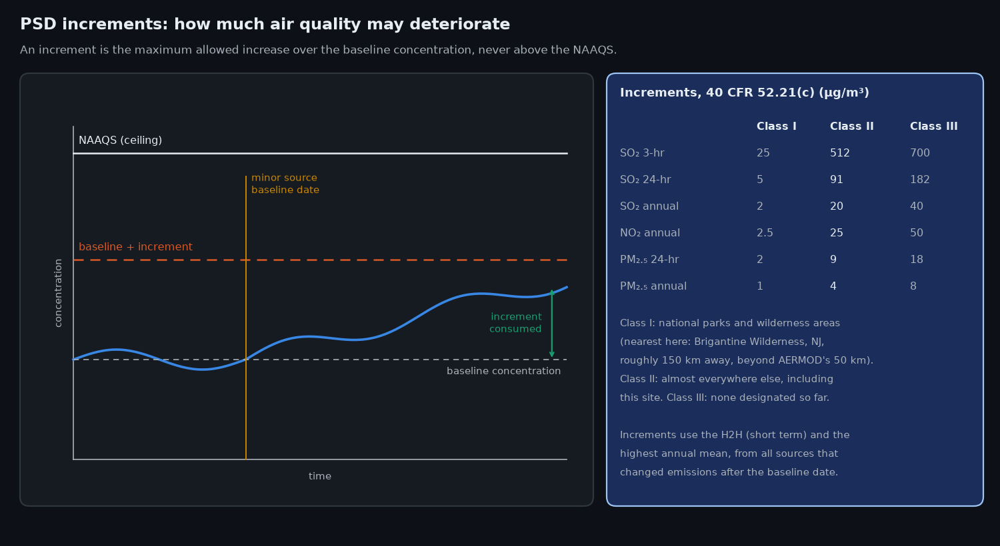

The nearest Class I area to this site is the Brigantine Wilderness in New Jersey, roughly 150 km away, beyond the 50 km range of AERMOD. The Federal Land Managers' first screen there is $Q/d$, the sum of SO₂, NOx, PM₁₀ and H₂SO₄ emissions (tpy) divided by the distance (km); for $Q/d \le 10$ they usually ask for no AQRV analysis (FLAG, 2010). Taking PM₁₀ equal to PM₂.₅ and leaving out H₂SO₄, this project gives $Q/d \approx 1{,}735/150 \approx 12$, so in a real application the Federal Land Managers would be consulted.

### Ambient Air, the Fenceline and Receptors

The standards apply to **ambient air**, defined as outdoor air to which the general public has access (40 CFR 50.1(e)). Areas inside a facility fence are generally not considered ambient air when access is restricted by the fence or other effective measures (EPA, 2019). For this reason, the receptor network in this project begins at the **fenceline**.

A **receptor** is a location where the dispersion model calculates pollutant concentrations. Receptors should be close together in areas where high concentrations are expected. The network must also extend far enough to identify where the modeled impact falls below the SIL. This project uses 3,225 receptors:

* 56 fenceline receptors every 25 m;
* nested Cartesian grids: 100 m spacing to ±1.5 km, 250 m to ±3 km, 500 m to ±10 km;
* polar rings every 10° at 12.5, 15, 20, 25, 30, 40 and 50 km, to locate the edge of the SIA.

### The Planetary Boundary Layer

Pollutants released near the surface are dispersed within the **planetary boundary layer (PBL)**, the lowest part of the atmosphere and the part most directly affected by the Earth's surface. The PBL changes throughout the day:

* **Daytime (convective boundary layer):** the sun heats the ground, warm air rises in thermals, and strong vertical mixing reaches up to the **convective mixing height** $z_{ic}$, often 1–2 km in summer.
* **Night (stable boundary layer):** the ground cools by radiation, the air near it becomes colder than the air above, and mixing is weak and limited to a shallow layer whose depth is set by wind shear: the **mechanical mixing height** $z_{im}$.

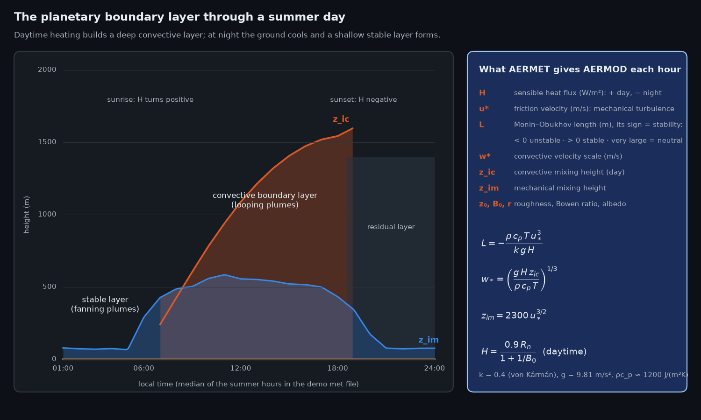

AERMOD does not assign one Pasquill stability class to each hour. Instead, it uses meteorological parameters that describe the turbulence and stability of the atmosphere. AERMET calculates these parameters for each hour:

* **Sensible heat flux** $H$ (W/m²): heat carried up from the ground by turbulence; positive by day, negative at night.
* **Friction velocity** $u_*$ (m/s): the strength of mechanical turbulence created by wind blowing over rough ground.
* **Monin–Obukhov length** $L$ (m): the height above which buoyancy, rather than wind shear, controls turbulence. $L < 0$ means unstable air, $L > 0$ stable air, and a very large $|L|$ means neutral air.

$$
L = -\frac{\rho\,c_p\,T\,u_*^3}{k\,g\,H}
$$

* $\rho\,c_p$: volumetric heat capacity of air (about 1,200 J/m³K); $T$: air temperature (K); $k = 0.4$: von Kármán constant; $g$: gravitational acceleration.
* **Convective velocity scale** $w_*$ (m/s): the typical speed of thermals, $w_* = \left(g\,H\,z_{ic} / \rho\,c_p\,T\right)^{1/3}$.
* **Surface characteristics:** roughness length $z_0$ (m), Bowen ratio $B_0$ (sensible over latent heat flux; high for dry ground) and albedo $r$ (fraction of sunlight reflected), from land cover via AERSURFACE.

The classic Gaussian plume model uses Pasquill stability classes A–F, while AERMOD uses parameters such as the Monin–Obukhov length. Both approaches describe atmospheric stability. Golder (1972) related the Pasquill classes to $L$ and $z_0$ using a linear relationship for each class: $1/L = a + b\,\log_{10} z_0$. Part A uses these relationships to assign a Pasquill class to each hour in the AERMET file.

### How AERMOD Models Dispersion

AERMOD is EPA's preferred model for assessing near-field dispersion from industrial sources, generally within 50 km (Appendix W, Section 4.2.2). It is a steady-state plume model, like the classic Gaussian model. The main difference is how it represents plume spread. Rather than using Pasquill–Gifford curves, AERMOD calculates the spread from hourly turbulence parameters ($\sigma_v$ and $\sigma_w$), which depend on $u_*$, $w_*$, and $L$:

* **Stable boundary layer:** a Gaussian plume in both directions.
* **Convective boundary layer:** updrafts are strong but narrow, while downdrafts are weak but cover about 60% of the area. The vertical velocity distribution is therefore skewed, and AERMOD represents it with two Gaussian distributions (a *bi-Gaussian* PDF). The plume is split into three parts: a *direct* plume carried down by downdrafts, an *indirect* plume lofted by updrafts and held at $z_i$, and a *penetrated* plume that rises through the top of the mixed layer and re-enters later (Cimorelli et al., 2005).

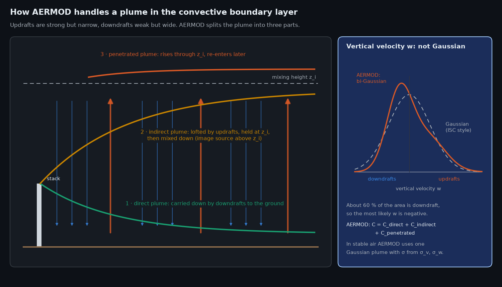

**Terrain** is handled with the **dividing streamline height** $H_c$. In stable flow, air below $H_c$ does not have enough energy to climb over a hill and goes around it, while air above $H_c$ goes over it. AERMOD computes the concentration as a weighted sum of a plume that stays horizontal and a plume that follows the terrain:

$$
C_T = f\,C_{\text{horizontal}} + (1 - f)\,C_{\text{terrain}}, \qquad f = 0.5\,(1 + \phi_p)
$$

where $\phi_p$ is the share of the plume below $H_c$. In convective hours $H_c = 0$, so each state gets half the weight. AERMAP provides each receptor's elevation and its hill height scale $h_c$, the terrain height that controls $H_c$.

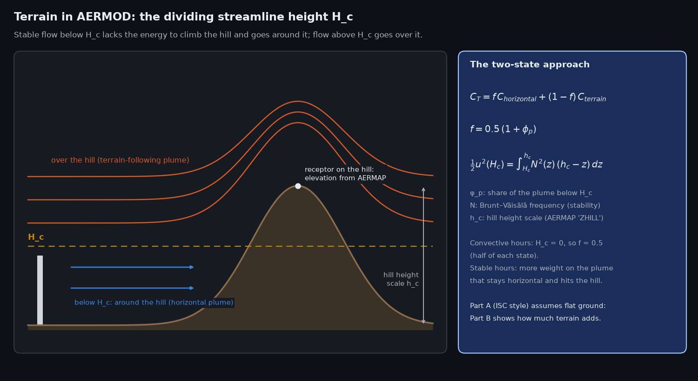

### Building Downwash and GEP Stack Height

When wind passes over a building, it creates a turbulent **wake**. A recirculating region, called the **cavity**, can also form just downwind of the building. If a stack releases its plume at a height similar to the building height, the plume may be drawn into this wake. This can increase ground-level concentrations close to the source.

AERMOD accounts for this effect using the **PRIME** algorithm (Schulman et al., 2000). The building dimensions for 36 wind directions are calculated by **BPIPPRM**.

Stacks may not be built artificially tall to dilute emissions. The **good engineering practice (GEP)** stack height (40 CFR 51.100(ii)) is the height needed to avoid downwash:

$$
H_{GEP} = H_b + 1.5\,L
$$

* $H_b$: height of the nearby building tier;
* $L$: the lesser of that tier's height and its maximum projected width;
* only buildings within $5L$ of the stack count, and $H_{GEP}$ is never taken below 65 m.

An emission limit may not take credit for stack height above GEP. A stack below GEP is allowed, but downwash must then be modeled.

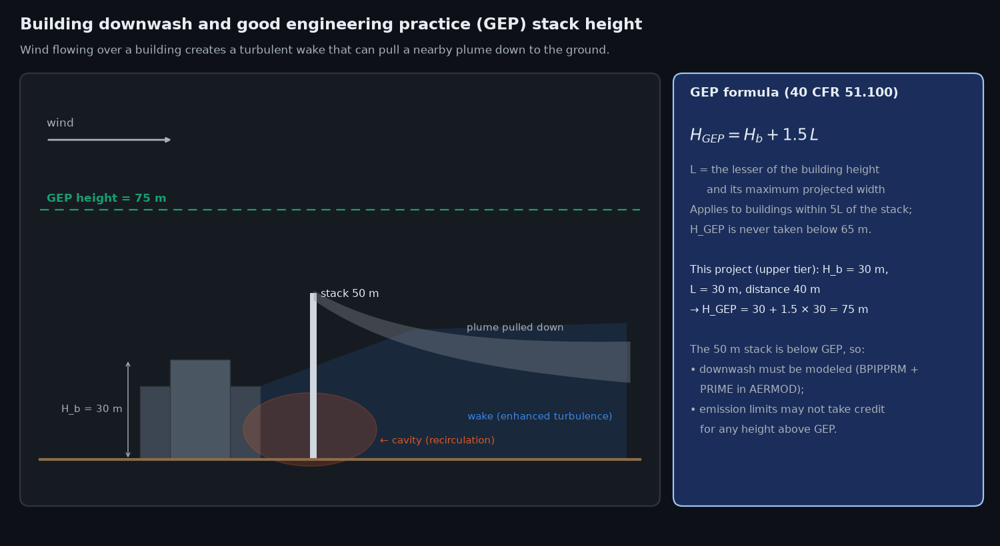

### NO₂: From NOx Emissions to NO₂ Concentrations

Combustion sources emit nitrogen oxides (NOx), mainly as nitric oxide (NO). As the plume travels downwind, ozone can convert NO to nitrogen dioxide (NO₂): $\text{NO} + \text{O}_3 \rightarrow \text{NO}_2 + \text{O}_2$. Sunlight can also break NO₂ back down into NO and oxygen. Because the amount of NO₂ formed depends on these reactions, AERMOD provides three modeling tiers (Appendix W, Section 4.2.3.4):

* **Tier 1:** all NOx is NO₂. Simple and most conservative.
* **Tier 2, ARM2 (Ambient Ratio Method 2):** the modeled hourly NOx is multiplied by an ambient NO₂/NOx ratio that falls as NOx rises. Podrez (2015) fitted the ratio to monitoring data as a 6th-order polynomial of NOx (µg/m³); AERMOD limits it to 0.5–0.9 by default.

$$
\begin{aligned}
\frac{\text{NO}_2}{\text{NO}_x} = {} & -1.1723\times10^{-17}x^6 + 4.2795\times10^{-14}x^5 - 5.8345\times10^{-11}x^4 \\
& + 3.4555\times10^{-8}x^3 - 5.6062\times10^{-6}x^2 - 2.7383\times10^{-3}x + 1.2441
\end{aligned}
$$

* **Tier 3:** chemistry limited by the available ozone: OLM (ozone limiting method), PVMRM and GRSM. They need hourly ozone data and the **in-stack ratio** (the NO₂/NOx fraction emitted directly); 0.5 is the conservative value used when no source test data exist (EPA, 2015). The simplest, OLM, for one source:

$$
\text{NO}_2 = \text{ISR}\cdot\text{NO}_x + \min\left[(1 - \text{ISR})\,\text{NO}_x,\ \tfrac{46}{48}\,[\text{O}_3]\right] \le 0.9\,\text{NO}_x
$$

### Secondary PM₂.₅ and MERPs

SO₂ and NOx can react in the atmosphere to form sulfate and nitrate particles. These reactions take place over several hours, so emissions of these gases can contribute to **secondary PM₂.₅** downwind of a source. AERMOD calculates directly emitted particles (primary PM₂.₅), but it does not simulate the atmospheric chemistry needed to form secondary particles.

EPA's permit-modeling guidance (EPA, 2022) describes two ways to estimate this contribution. Tier 1 uses **Modeled Emission Rates for Precursors (MERPs)**. Tier 2 uses photochemical grid modeling. In the 2024 update to the MERPs guidance, the Tier 1 estimate is based on hypothetical sources that EPA modeled with a photochemical model:

$$
\text{secondary impact} = \sum_{\text{precursors}} \text{project emissions (tpy)} \times \frac{\text{modeled impact of the hypothetical source}}{\text{its modeled emission rate}}
$$

and added to the modeled primary PM₂.₅ before comparing with the SIL, the NAAQS and the increments.

### Design Values in Modeling

This project uses five years of National Weather Service (NWS) meteorological data. For the modeled analysis, the five-year average of the relevant statistic is used in place of the three-year average specified in the standard, consistent with EPA's 2010–2011 memoranda. The figure below walks through the 1-hour SO₂ design-value calculation. The table lists the statistical form used for each regulatory test in this project.

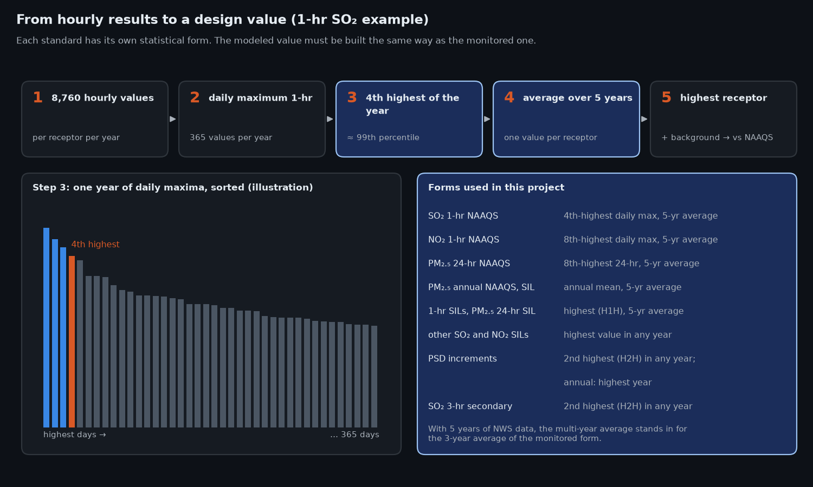

## The AERMOD Modeling System (Part B)

AERMOD uses several preprocessing programs. Each program prepares a specific set of input data for the next step in the modeling chain. In Part B, the full chain was run using the available real data. The results are presented in [Results (Part B)](#results-part-b-aermod-with-real-data):

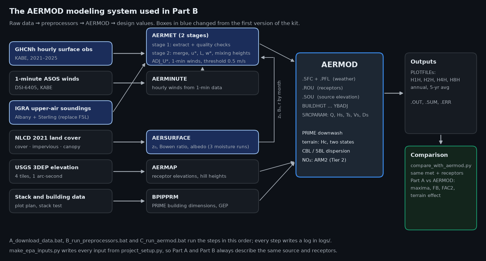

| Program (version) | What it does | Settings in this repository |
| :--- | :--- | :--- |
| AERSURFACE (26135) | $z_0$ by sector within 1 km, and $B_0$ and albedo over a 10 km × 10 km area, around the met station, from land cover | NLCD 2021 land cover, impervious and tree canopy; 12 sectors (`VARYZ0`, all `LOWZ0` for the airfield); monthly; three runs (average, wet, dry surface moisture) |
| AERMINUTE (26135) | hourly winds from 2-minute averages reported every minute by ASOS, which removes most calms and variable winds | 57 monthly KABE files for 2021–2025 (08/2025, 09/2025 and 12/2025 are not in the NCEI archive) |
| AERMET (26135) | stage 1: extract and check the data; stage 2: merge and compute $H$, $u_*$, $L$, $w_*$, $z_{ic}$, $z_{im}$ | GHCNh surface data, IGRA soundings, 1-minute winds, `ADJ_U*`, `THRESH_1MIN 0.5`, cloud and temperature substitution, 12Z Albany soundings with Sterling, VA substituted on days without one (`UPP_SUB SUBUA_SEC1`), randomized wind directions; each year gets the AERSURFACE file of its surface moisture |
| AERMAP (24142) | receptor and source elevations and hill height scales from a DEM | four USGS 3DEP 1 arc-second tiles, 55 km domain, 3,225 receptors |
| BPIPPRM (04274) | building dimensions for PRIME, GEP height | two-tier boiler hall; GEP = 75 m |
| AERMOD (26135) | concentrations and design values | three five-year runs (SO₂ 1-hour; NO₂ 1-hour and annual with ARM2; PM₂.₅ 24-hour and annual) and fifteen one-year runs for the H1H, H2H and annual values; optional Tier 3 OLM run |

## Methodology (Part A)

Part A uses a transparent hourly Gaussian plume model based on the ISCST3 formulation (EPA, 1995). The Python code is available for inspection, so the calculations can be followed and checked. This model provides a reference case for the comparison with AERMOD in Part B.

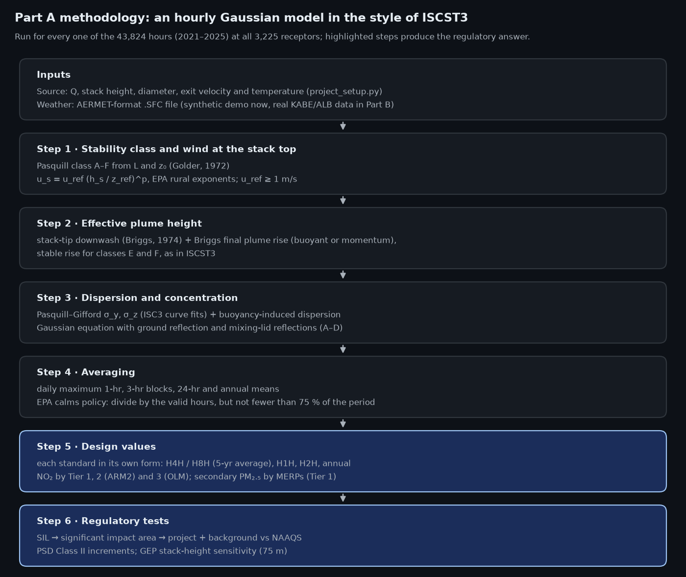

### Step 1: Meteorology

The Part A model can read any meteorological file in AERMET surface-file format. The first run uses a synthetic five-year file, `SYNTHETIC_DEMO_2021_2025.SFC`, created by `make_demo_met.py`. Temperature, wind, cloud cover, and pressure are generated from basic climate statistics for the Lehigh Valley. The script then calculates the boundary-layer parameters using equations also used by AERMET:

* Net radiation (Holtslag & van Ulden, 1983), with solar elevation $\phi$ and cloud fraction $N$:

$$
R_n = \frac{(1 - r)\,R + c_1\,T^6 - \sigma\,T^4 + c_2\,N}{1 + c_3}, \qquad R = (990\sin\phi - 30)(1 - 0.75\,N^{3.4})
$$

* with $c_1 = 5.31\times10^{-13}$ W/m²K⁶, $c_2 = 60$ W/m², $c_3 = 0.12$ and $\sigma = 5.67\times10^{-8}$ W/m²K⁴.
* Daytime heat flux $H = 0.9\,R_n / (1 + 1/B_0)$; $u_*$ and $L$ by iterating the Monin–Obukhov wind profile with the Paulson (1970) correction.
* Night: $u_*$, $L$ and $H$ from the temperature scale $\theta_* = 0.09\,(1 - 0.5N^2)$ (Venkatram, 1980; van Ulden & Holtslag, 1985).
* Convective mixing height from the heat put into the layer since sunrise, $z_{ic}^2 = 2\,(1 + 2A)\int H\,dt\,/\,(\rho\,c_p\,\gamma)$ with $A = 0.2$ and $\gamma$ the potential temperature gradient above the layer (Carson, 1973; Weil & Brower, 1983).
* Mechanical mixing height $z_{im} = 2300\,u_*^{3/2}$ with AERMET's hourly smoothing.

| Season | $z_0$ (m) | Bowen ratio | Albedo |
| :--- | :---: | :---: | :---: |
| Winter (Dec–Feb) | 0.08 | 1.00 | 0.18 |
| Spring (Mar–May) | 0.09 | 0.60 | 0.16 |
| Summer (Jun–Aug) | 0.12 | 0.60 | 0.17 |
| Autumn (Sep–Nov) | 0.10 | 0.90 | 0.17 |

These values are representative of open grassland and airport surfaces. In Part B, AERSURFACE calculates the surface characteristics from land-cover data. The synthetic meteorological file is designed to be physically consistent, but it does not contain actual observations. Therefore, the first Part A results demonstrate how the model works; they should not be interpreted as predictions for real weather conditions. For the comparison with AERMOD, Part A is run again using the real AERMET file, `03_AERMET/KABE_2021_2025.SFC`.

### Step 2: Stability Class

For each hour, the model calculates $1/L$ and compares it with the Golder (1972) relationships. It assigns the Pasquill class whose line, $1/L = a + b\,\log_{10} z_0$, is closest to the hourly value:

| Class | A | B | C | D | E | F |
| :--- | :---: | :---: | :---: | :---: | :---: | :---: |
| $a$ | −0.096 | −0.037 | −0.002 | 0 | 0.004 | 0.035 |
| $b$ | 0.029 | 0.029 | 0.018 | 0 | −0.018 | −0.036 |

### Step 3: Wind at the Stack Top

$$
u_s = u_{ref}\left(\frac{h_s}{z_{ref}}\right)^p
$$

The rural exponents used for stability classes A–F are 0.07, 0.07, 0.10, 0.15, 0.35, and 0.55, respectively. Following ISCST3, reference wind speeds below 1 m/s are set to 1 m/s. Calm hours, defined here as wind speeds below 0.5 m/s, are excluded from the dispersion calculations.

### Step 4: Effective Plume Height

**Stack-tip downwash** (Briggs, 1974): when the exit velocity is less than 1.5 times the wind speed, the plume is pulled down behind the stack lip:

$$
h' = h_s + 2\,d\left(\frac{v_s}{u_s} - 1.5\right) \quad \text{for } v_s < 1.5\,u_s
$$

**Briggs final plume rise**, as in ISCST3, uses the buoyancy flux $F_b$ and the momentum flux $F_m$:

$$
F_b = g\,v_s\,d^2\,\frac{T_s - T_a}{4\,T_s}, \qquad F_m = v_s^2\,d^2\,\frac{T_a}{4\,T_s}
$$

* Classes A–D: buoyant rise $\Delta h = 21.425\,F_b^{3/4}/u_s$ for $F_b < 55$, $\Delta h = 38.71\,F_b^{3/5}/u_s$ for $F_b \ge 55$; momentum rise $\Delta h = 3\,d\,v_s/u_s$; the larger applies (this is ISCST3's crossover-temperature rule).
* Classes E and F: stability parameter $s = g\,(\partial\theta/\partial z)/T_a$ with $\partial\theta/\partial z$ = 0.020 K/m (E) and 0.035 K/m (F); buoyant rise $\Delta h = 2.6\,(F_b/(u_s\,s))^{1/3}$, momentum rise $1.5\,(F_m/(u_s\sqrt{s}))^{1/3}$ (but not more than the neutral $3\,d\,v_s/u_s$).

The effective height is $h_e = h' + \Delta h$. ISCST3 uses the final rise at all distances.

### Step 5: Dispersion Coefficients

$\sigma_y$ and $\sigma_z$ come from the Pasquill–Gifford curves in the form used by ISC3 ($x$ in km):

$$
\sigma_y = 465.11628\,x\,\tan\left[0.017453293\,(c - d\ln x)\right], \qquad \sigma_z = a\,x^b \le 5000\ \text{m}
$$

with $c$, $d$ per class and $a$, $b$ per class and distance range (EPA, 1995, Tables 1-1 and 1-2; listed in `hourly_gaussian_model.py`). At 1 km they give $\sigma_y$ = 68 m and $\sigma_z$ = 32 m for class D, and 34 m and 14 m for class F, the values of Turner's workbook. **Buoyancy-induced dispersion** adds the spread caused by the rising plume itself: $\sigma^2 \rightarrow \sigma^2 + (\Delta h/3.5)^2$.

### Step 6: Concentration at Ground Level

For a ground-level receptor at downwind distance $x$ and crosswind distance $y$:

$$
\frac{C}{Q} = \frac{1}{2\pi\,u_s\,\sigma_y\,\sigma_z}\,\exp\left(-\frac{y^2}{2\sigma_y^2}\right)\,V
$$

* Classes E and F (no lid): $V = 2\exp(-h_e^2/2\sigma_z^2)$, the plume and its reflection from the ground.
* Classes A–D, with mixing height $z_i$ (the larger of $z_{ic}$ and $z_{im}$ in daytime): the plume is reflected between the ground and the lid,

$$
V = \sum_{n=-4}^{4}\left[\exp\left(-\frac{(2nz_i - h_e)^2}{2\sigma_z^2}\right) + \exp\left(-\frac{(2nz_i + h_e)^2}{2\sigma_z^2}\right)\right]
$$

* and once $\sigma_z > 1.6\,z_i$ the plume is uniformly mixed: $V = \sqrt{2\pi}\,\sigma_z / z_i$. If $h_e > z_i$, the plume is above the lid and the ground-level concentration is zero.

The regulatory comparisons use ground-level concentrations. The three-dimensional plume plots also show concentrations at heights $z$ above the ground. These values are calculated using the same image-source approach, with the receptor height included in each term:

$$
V(z) = \sum_{n=-4}^{4}\left[\exp\left(-\frac{(z - h_e + 2nz_i)^2}{2\sigma_z^2}\right) + \exp\left(-\frac{(z + h_e + 2nz_i)^2}{2\sigma_z^2}\right)\right], \qquad z \le z_i
$$

* For classes E and F only the $n = 0$ terms remain; above the lid ($z > z_i$) the concentration is zero for classes A–D. At $z = 0$ this is exactly the ground-level equation above, which the code checks.

### Step 7: Averaging and Calm Hours

For every receptor and year, the model calculates the daily maximum 1-hour concentration, 3-hour block averages (hours 1–3, 4–6, and so on), 24-hour averages, and the annual mean. EPA's calms policy is applied to each block average: the sum of the valid hourly values is divided by the number of valid hours, provided that at least 75% of the hours are available. This means at least three valid hours for a 3-hour average and 18 valid hours for a 24-hour average. The annual mean is calculated using the available valid hours.

### Step 8: Design Values and Regulatory Tests

| Use | Form at each receptor (then the highest receptor) |
| :--- | :--- |
| SO₂ 1-hour NAAQS | 4th-highest daily maximum 1-hour (99th percentile), 5-year average |
| NO₂ 1-hour NAAQS | 8th-highest daily maximum 1-hour (98th percentile), 5-year average |
| PM₂.₅ 24-hour NAAQS | 8th-highest 24-hour value (98th percentile), 5-year average |
| PM₂.₅ annual NAAQS and SIL, SO₂ annual secondary | annual mean, 5-year average |
| 1-hour SILs, PM₂.₅ 24-hour SIL | highest (H1H) value, 5-year average |
| SO₂ 3-hour, 24-hour and annual SILs, NO₂ annual | highest value in any year |
| SO₂ 3-hour secondary NAAQS, short-term increments | highest second-high (H2H) in any year |
| annual increments | highest annual mean in any year |

The model results are then assessed in three stages. First, project-only concentrations are compared with the SILs, and the significant impact area (SIA) is identified. Next, background concentrations are added and the totals are compared with the NAAQS. Finally, the project impacts are compared with the Class II PSD increments.

The analysis also examines three approaches for estimating NO₂ (Tier 1, Tier 2 using ARM2, and Tier 3 using OLM with an in-stack ratio of 0.5 and constant ozone of 45 ppb). Secondary PM₂.₅ is estimated using the Tier 1 MERPs method. A final sensitivity run increases the stack height from 50 m to its GEP height of 75 m.

## Case Study: Apex Unit B1

### List of Parameters

| Parameter | Value |
| :--- | :--- |
| Location | UTM zone 18 N (NAD83) 492,555 E, 4,515,000 N (about 40.79° N, 75.09° W); base elevation 125 m (AERMAP gives 128 m from the terrain data) |
| Stack height, inside diameter | 50 m, 2.6 m |
| Exit velocity, exit temperature | 18.5 m/s, 415 K |
| Emission rates | SO₂ 28.5 g/s, NOx (as NO₂) 19.0 g/s, PM₂.₅ 2.4 g/s |
| Building | two-tier boiler hall west of the stack: lower tier 60 m × 40 m, 22 m high (25 m from the stack); upper tier 30 m × 25 m, 30 m high (40 m from the stack) |
| Property (fence) | 400 m × 300 m around the stack |
| Meteorology | surface: Allentown, KABE (WBAN 14737), 33 km west-southwest, anemometer 7.9 m; upper air: Albany, NY (72518), with Sterling, VA (72403) on days without an Albany sounding; 2021–2025 |
| Receptors | 3,225 (fenceline, three nested grids, polar rings to 50 km) |
| Dispersion setting | rural |

At an ambient temperature of 10 °C, the calculated buoyancy flux is $F_b$ = 97.4 m⁴/s³ and the momentum flux is $F_m$ = 395 m⁴/s². The estimated buoyant plume rise is 302 m at a wind speed of 2 m/s, 121 m at 5 m/s, and 60 m at 10 m/s. These values are about four times the momentum-driven rise, indicating that buoyancy is the main influence on plume rise.

### Is the Project Subject to PSD?

| Pollutant | g/s | tons per year (8,760 h) | SER (tpy) | Reviewed? |
| :--- | :---: | :---: | :---: | :---: |
| SO₂ | 28.5 | 990.7 | 40 | yes |
| NOx | 19.0 | 660.5 | 40 | yes (NO₂, and as a PM₂.₅ precursor) |
| PM₂.₅ | 2.4 | 83.4 | 10 | yes |

The facility is treated as a fossil-fuel-fired steam plant, so the major-source threshold is 100 tpy. Its emissions also exceed the SER for each pollutant. Therefore, SO₂, NO₂, and PM₂.₅ all require a full air-quality analysis.

### GEP Stack Height

The upper building tier is 30 m high and measures 30 m × 25 m in plan. Its maximum projected width is the diagonal, $\sqrt{30^2 + 25^2}$ = 39 m. Therefore, $L$ is the smaller of the tier height and projected width: $L = \min(30, 39)$ = 30 m. The tier is 40 m from the stack, which is within the required distance of $5L$ = 150 m:

$$
H_{GEP} = 30 + 1.5 \times 30 = 75\ \text{m}
$$

The lower tier gives a GEP height of 55 m. However, the minimum value used here is 65 m, so the controlling GEP stack height is 75 m. The actual stack is 50 m high and is therefore below GEP. Building downwash must be included in the AERMOD analysis using PRIME. The facility also cannot use the additional stack height above GEP to justify higher emission limits.

## Results (Part A): Hourly Gaussian Model with Synthetic Weather

This section presents the Part A results using the synthetic meteorological file. These results illustrate the model calculations; they are not the final site assessment. The results based on real meteorological data, together with the AERMOD comparison, are presented in [Results (Part B)](#results-part-b-aermod-with-real-data).

### Meteorology

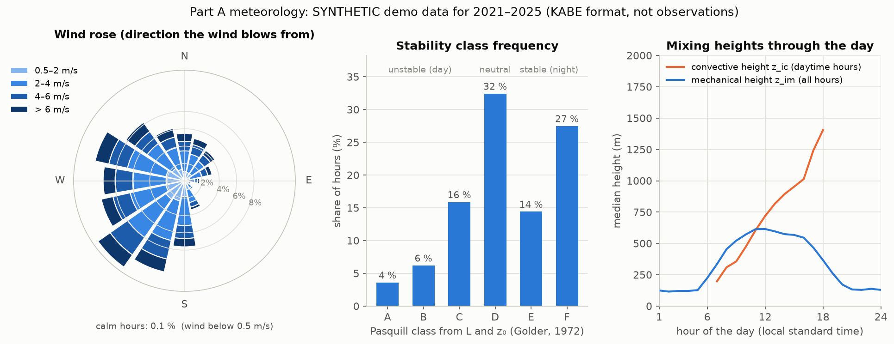

The synthetic year is dominated by westerly and south-westerly winds, consistent with the general wind pattern in the Lehigh Valley. The mean wind speed is 3.8 m/s, and calm conditions account for only 0.1% of the hours. This low calm frequency is typical of datasets that use 1-minute wind observations. Neutral conditions (Class D) occur most often (32%), followed by stable Class F conditions (28%), which are mainly associated with nighttime hours. The convective mixing height increases from about 200 m after sunrise to approximately 1,400 m by late afternoon.

### Design-Value Maps

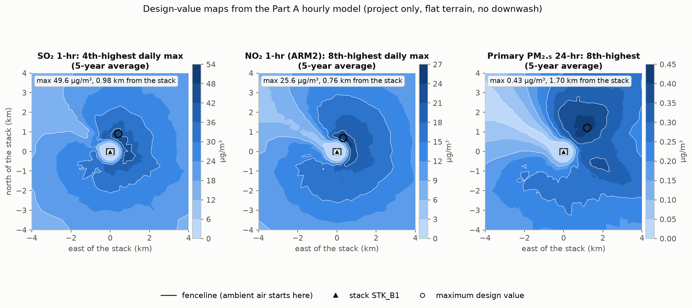

The highest 1-hour concentrations occur 0.8–1.0 km from the stack. They are associated with unstable conditions and relatively light winds, when the rising plume is mixed down to ground level. Concentrations close to the stack are lower because this model assumes that the plume reaches its final rise immediately. Since Part A does not include building downwash, there is no mechanism to bring the plume down close to the fenceline. The highest 24-hour PM₂.₅ concentration occurs farther away, at about 1.7 km, in the direction of the prevailing north-easterly plume transport.

### Regulatory Comparison

| Test | Pollutant | Averaging time | Project (µg/m³) | Background | Total | Limit | Result |
| :--- | :--- | :--- | ---: | ---: | ---: | ---: | :--- |
| SIL | SO₂ | 1-hour | 66.1 | – | 66.1 | 7.8 | **above** |
| SIL | SO₂ | 3-hour | 51.0 | – | 51.0 | 25 | **above** |
| SIL | SO₂ | 24-hour | 13.2 | – | 13.2 | 5 | **above** |
| SIL | SO₂ | annual | 1.003 | – | 1.003 | 1 | **above** (by 0.3%) |
| SIL | NO₂ | 1-hour | 39.7 | – | 39.7 | 7.5 | **above** |
| SIL | NO₂ | annual | 0.60 | – | 0.60 | 1 | below |
| SIL | PM₂.₅ | 24-hour | 7.79 (0.72 + 7.06 secondary) | – | 7.79 | 1.2 | **above** |
| SIL | PM₂.₅ | annual | 0.342 (0.070 + 0.272 secondary) | – | 0.342 | 0.13 | **above** |
| NAAQS | SO₂ | 1-hour | 49.6 | 13.1 | 62.7 | 196.4 | below (32%) |
| NAAQS | SO₂ | 3-hour | 39.2 | 13.1 | 52.3 | 1,300 | below (4%) |
| NAAQS | SO₂ | annual | 0.83 | 2.6 | 3.45 | 26.2 | below (13%) |
| NAAQS | NO₂ | 1-hour | 25.6 | 75.3 | 100.9 | 188 | below (54%) |
| NAAQS | NO₂ | annual | 0.60 | 18.8 | 19.4 | 100 | below (19%) |
| NAAQS | PM₂.₅ | 24-hour | 7.50 | 20.0 | 27.5 | 35 | below (79%) |
| NAAQS | PM₂.₅ | annual | 0.342 | 8.0 | 8.34 | 9.0 | below (93%) |
| Class II increment | SO₂ | 3-hour | 39.2 | – | 39.2 | 512 | below (8%) |
| Class II increment | SO₂ | 24-hour | 8.99 | – | 8.99 | 91 | below (10%) |
| Class II increment | SO₂ | annual | 1.00 | – | 1.00 | 20 | below (5%) |
| Class II increment | NO₂ | annual | 0.60 | – | 0.60 | 25 | below (2%) |
| Class II increment | PM₂.₅ | 24-hour | 7.82 | – | 7.82 | 9 | below (87%) |
| Class II increment | PM₂.₅ | annual | 0.357 | – | 0.357 | 4 | below (9%) |

The background concentrations used here are **illustrative values**, not measurements from local monitoring stations: 5 ppb SO₂, 40 ppb and 10 ppb NO₂, and 20 and 8.0 µg/m³ PM₂.₅. The demonstration also does not include emissions from nearby sources.

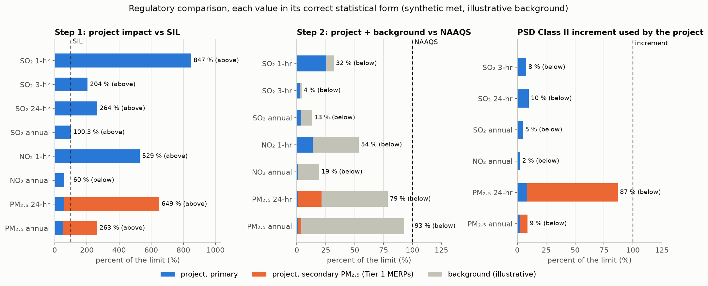

* **SIL assessment:** The project exceeds the SIL for every averaging period except annual NO₂. A cumulative analysis is therefore required for the pollutants and averaging periods that exceed their SILs. The annual SO₂ result is only 0.3% above its SIL, and this occurs at two receptors.
* **NAAQS assessment:** After adding the illustrative background concentrations, all modeled totals remain below the NAAQS. The closest result to its limit is annual PM₂.₅, at 93% of the standard. Most of this total comes from the assumed background concentration. The 24-hour PM₂.₅ result reaches 79% of its standard.
* **Secondary PM₂.₅:** The primary PM₂.₅ impacts (0.72 µg/m³ for 24 hours and 0.070 µg/m³ annually) are below their respective SILs. The SIL exceedances occur only after adding the Tier 1 secondary PM₂.₅ estimate, based on approximately 1,650 tpy of SO₂ and NOx emissions. This estimate uses the most conservative hypothetical sources in EPA's 2019 MERPs guidance, so it should be treated as an upper-bound estimate. It also accounts for 87% of the 24-hour Class II increment. A more representative next step would be to use the MERPs hypothetical sources developed for the Northeast or carry out Tier 2 photochemical modeling.

### Significant Impact Area

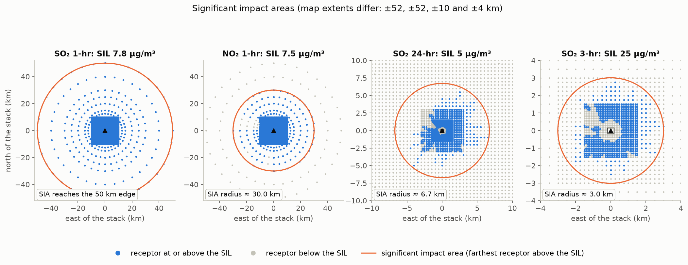

| Pollutant and averaging time | SIA radius |
| :--- | :--- |
| SO₂ 1-hour | reaches the 50 km edge of the receptor network |
| NO₂ 1-hour | 30 km |
| SO₂ 24-hour | 6.7 km |
| SO₂ 3-hour | 3.0 km |
| SO₂ annual | 2.1 km (two receptors) |
| PM₂.₅ | the whole domain, because the secondary estimate is a single value added everywhere |

The 1-hour SIAs extend a long distance from the source because the SIL assessment is based on the highest daily value at each receptor in each year. At distances of 40–50 km, the controlling values come from a small number of stable, low-wind hours. Under these conditions, the model transports the plume over a long distance with relatively little dilution.

This result should be interpreted with care. A steady-state model assumes that the wind and other meteorological conditions during one hour remain representative along the entire plume path. That assumption becomes less realistic when the modeled transport distance is large and the travel time is several hours. This limitation applies to steady-state plume models, including AERMOD. For a regulatory application, the SIA is limited to the 50 km modeling domain, and the cumulative analysis would cover that area.

### NO₂ Tiers

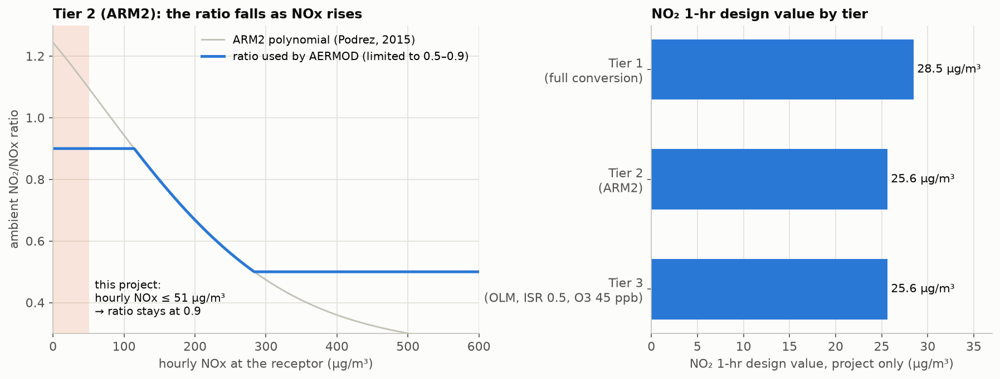

The modeled hourly NOx concentrations at the receptors do not exceed about 51 µg/m³. This is well below the 115 µg/m³ level at which the ARM2 ratio begins to decrease. As a result, ARM2 uses its maximum NO₂/NOx ratio of 0.9 throughout the receptor network.

The OLM calculation gives a similar result. With the assumed ozone concentration of 45 ppb, enough ozone is available to convert the modeled NO to NO₂, so the 0.9 upper limit controls the result. For this tall, buoyant stack, moving from Tier 1 to Tier 2 or Tier 3 changes the 1-hour NO₂ design value by only about 10% (from 28.5 to 25.6 µg/m³). These refinements can have a larger effect for low-level sources with high NOx concentrations near the source.

### GEP Stack Height Sensitivity

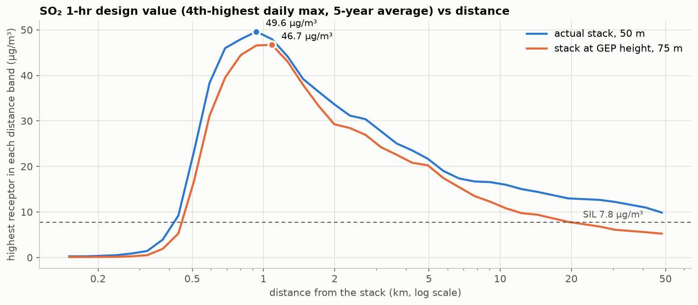

Increasing the stack height from 50 m to the 75 m GEP height reduces the maximum 1-hour SO₂ design value by only 6% in Part A (from 49.6 to 46.7 µg/m³). The reason is that plume rise, which ranges from about 60 to 300 m, has a much larger influence on the effective release height than the 25 m increase in physical stack height.

The AERMOD results in Part B show a larger reduction of about 18% (from 2,400 to 1,980 µg/m³). However, the concentration remains far above the standard. The ridge is higher than the release point even with the 75 m stack, so increasing the stack height alone does not resolve the terrain-related impact.

### The Plume in 3D

The three figures show the modeled plume for each pollutant during the highest-concentration hour in the five-year period. The horizontal axes show the downwind and crosswind distances from the stack. The vertical axis shows height above ground level, starting at 0 m. Colour represents concentration: light blue indicates lower concentrations, while dark blue indicates higher concentrations.

The plume in the air is shown as a cloud of points. Filled contours on the ground show the ground-level concentrations used in the regulatory comparisons. The colour scale is logarithmic because concentrations decrease by more than two orders of magnitude between the plume centre and its outer edges.

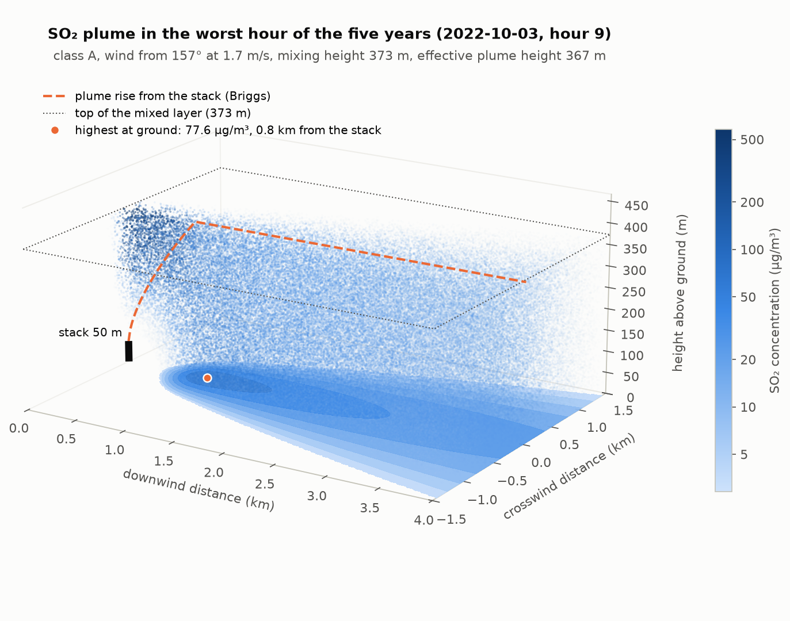

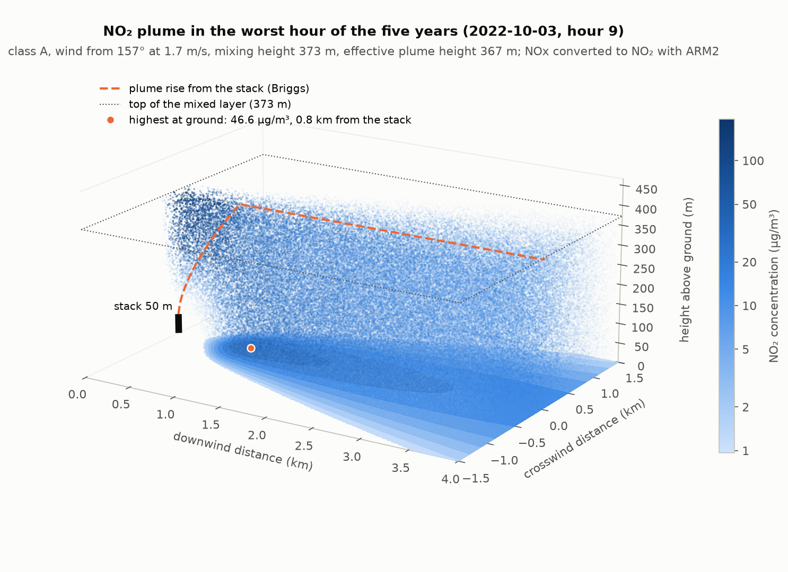

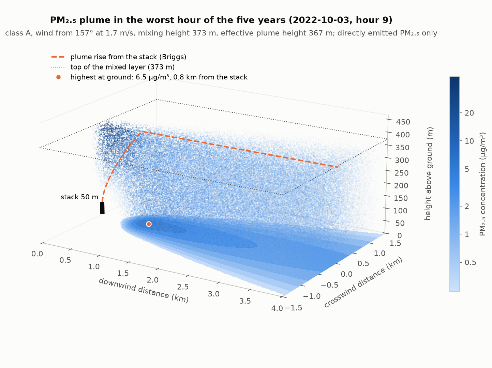

The main features of the plots are:

* **Meteorological conditions during the highest-impact hour:** The controlling hour is 3 October 2022, from 08:00 to 09:00. It is a Class A morning with a wind speed of 1.7 m/s. The plume rises from the 50 m stack to 367 m, as shown by the orange dashed line. This is just below the mixed-layer height of 373 m, shown by the dotted rectangle. The mixed layer limits further vertical movement, and strong convection mixes the plume through the layer. The plume reaches the ground about 0.8 km from the stack.
* **The three pollutants follow the same plume path:** SO₂, NOx, and PM₂.₅ are released from the same stack under the same meteorological conditions. Their plume shapes are therefore similar; the main difference is the emission rate (28.5 g/s SO₂, 19.0 g/s NOx, and 2.4 g/s PM₂.₅). The highest ground-level concentrations on the fine plotting grid are 77.6 µg/m³ for SO₂, 46.6 µg/m³ for NO₂, and 6.5 µg/m³ for PM₂.₅. The nearest SO₂ receptor gives a value of about 76 µg/m³.
* **NO₂:** The plotted NO₂ plume is calculated from NOx using the ARM2 method (Tier 2). At ground level, NOx remains below 115 µg/m³, so ARM2 applies its maximum ratio of 0.9. Higher in the plume, NOx reaches several hundred µg/m³ and the ratio decreases toward 0.5. The NO₂ concentration in the upper plume is therefore lower relative to the SO₂ concentration.
* **PM₂.₅:** This plot includes only particles emitted directly from the stack. Secondary PM₂.₅ forms later through atmospheric reactions involving SO₂ and NOx. It is therefore estimated separately using MERPs rather than shown as part of this hourly plume.
* **Plume rise near the stack:** The dark plume core appears at a height of 367 m even close to the stack. This happens because, following ISCST3, the model applies the final plume rise at every downwind distance. The orange line shows the gradual rise predicted by the Briggs 2/3 law over the first 0.6 km. As a result, the plotted plume is higher than the physical plume would be near the stack. This simplification does not affect the ground-level results beyond about 0.6 km, where the maximum occurs.
* **Interaction with the mixing-layer top:** If the plume rose just one metre higher, it would pass above the mixing-layer top. In this model, that would make its ground-level contribution zero. This occurs in 2.8% of the Class A–D hours and 10% of Class A hours. AERMOD avoids this abrupt change by including a treatment for plume penetration through the top of the mixed layer.

## Results (Part B): AERMOD with Real Data

The full EPA modeling chain was run on 26–27 November 2026. The supporting report, [RESULTS_AERMOD.md](RESULTS_AERMOD.md), documents the input data, data-quality checks, and issues identified and corrected during processing. This section summarizes the main results.

### Meteorology and Data Checks

* **Surface:** Allentown KABE, GHCNh hourly data for 2021–2025 (43,824 hours): 1,044 calm hours (2.4%) and 566 missing hours (1.3%). Every quarter is at least 94% complete; EPA asks for 90%.
* **1-minute winds:** AERMINUTE read 57 of the 60 months (three are not in the NCEI archive); the 1-minute winds cover 86% of the hours. The anemometer is 7.9 m (26 ft) above the ground.
* **Upper air:** Albany, NY has a morning (12Z) sounding on 1,360 of the 1,826 days; most gaps fall between December 2022 and October 2023. AERMET filled them with the Sterling, VA sounding (455 days) or a sounding from the day before or after (5 days); only 4 days (2–5 April 2022) have none.
* **Surface characteristics:** AERSURFACE with NLCD 2021 around the airport; 2021–2024 are years of average surface moisture and 2025 a dry year.
* **Terrain:** AERMAP with four USGS 3DEP 1 arc-second tiles puts the stack base at 128 m and the ridge south-east of the plant at 230–260 m.

### Regulatory Tests with AERMOD

The same standards, illustrative background concentrations, and secondary PM₂.₅ estimate used in Part A are also used here. The final column gives the distance between the stack and the receptor with the highest design value.

| Test | Pollutant | Averaging time | Project (µg/m³) | Background | Total | Limit | Result | Where (km) |
| :--- | :--- | :--- | ---: | ---: | ---: | ---: | :--- | ---: |
| SIL | SO₂ | 1-hour | 2,550 | – | 2,550 | 7.8 | **above** | 0.42 |
| SIL | SO₂ | 3-hour | 1,760 | – | 1,760 | 25 | **above** | 0.54 |
| SIL | SO₂ | 24-hour | 426 | – | 426 | 5 | **above** | 0.42 |
| SIL | SO₂ | annual | 33.7 | – | 33.7 | 1 | **above** | 0.45 |
| SIL | NO₂ | 1-hour | 849 | – | 849 | 7.5 | **above** | 0.42 |
| SIL | NO₂ | annual | 13.2 | – | 13.2 | 1 | **above** | 0.45 |
| SIL | PM₂.₅ | 24-hour | 30.6 | – | 30.6 | 1.2 | **above** | 0.45 |
| SIL | PM₂.₅ | annual | 2.43 | – | 2.43 | 0.13 | **above** | 0.45 |
| NAAQS | SO₂ | 1-hour | 2,400 | 13.1 | 2,410 | 196.4 | **above** | 0.45 |
| NAAQS | SO₂ | 3-hour | 1,470 | 13.1 | 1,480 | 1,300 | **above** | 0.54 |
| NAAQS | SO₂ | annual | 25.6 | 2.6 | 28.2 | 26.2 | **above** | 0.45 |
| NAAQS | NO₂ | 1-hour | 758 | 75.3 | 833 | 188 | **above** | 0.45 |
| NAAQS | NO₂ | annual | 13.2 | 18.8 | 32.0 | 100 | below | 0.45 |
| NAAQS | PM₂.₅ | 24-hour | 19.4 | 20.0 | 39.4 | 35 | **above** | 0.45 |
| NAAQS | PM₂.₅ | annual | 2.43 | 8.0 | 10.4 | 9.0 | **above** | 0.45 |
| Class II increment | SO₂ | 3-hour | 1,470 | – | 1,470 | 512 | **above** | 0.54 |
| Class II increment | SO₂ | 24-hour | 302 | – | 302 | 91 | **above** | 0.45 |
| Class II increment | SO₂ | annual | 33.7 | – | 33.7 | 20 | **above** | 0.45 |
| Class II increment | NO₂ | annual | 13.2 | – | 13.2 | 25 | below | 0.45 |
| Class II increment | PM₂.₅ | 24-hour | 32.5 | – | 32.5 | 9 | **above** | 0.45 |
| Class II increment | PM₂.₅ | annual | 3.11 | – | 3.11 | 4 | below | 0.45 |

The PM₂.₅ results include the Tier 1 secondary contribution: 7.06 µg/m³ for the 24-hour value and 0.27 µg/m³ for the annual value. When OLM (Tier 3, with a constant ozone concentration of 45 ppb) is used instead of ARM2, the 1-hour NO₂ design value is 842 µg/m³. These values agree with the summary tables produced by AERMOD in the `.out` files.

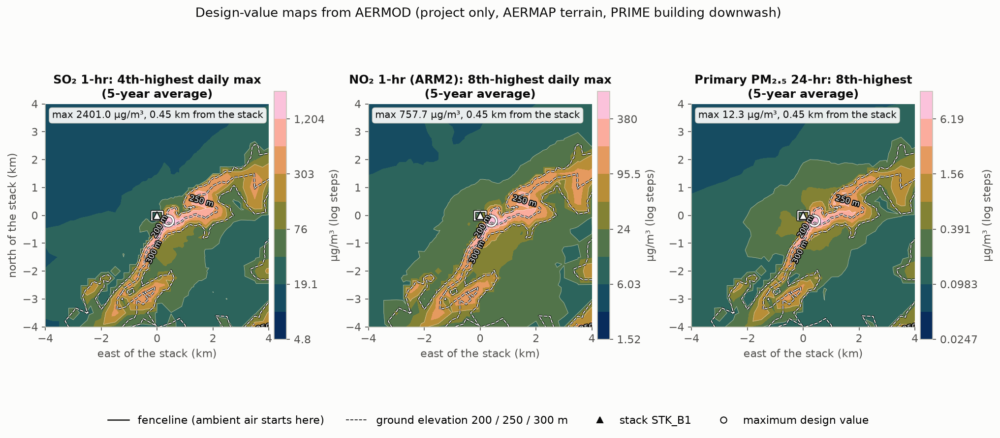

The highest concentrations occur along the ridge to the south-east and north-east of the facility. The dashed lines mark terrain elevations of 200, 250, and 300 m. Concentrations are shown on a logarithmic scale using the *batlow* colour map (Crameri, 2018).

### AERMOD Against Part A

The script `compare_with_aermod.py` runs the Part A model using the same AERMET file as AERMOD. It then compares the primary pollutant impacts from both models at the same 3,225 receptors:

| Design value | Part A max (µg/m³) | AERMOD max (µg/m³) | Part A / AERMOD | Receptors within a factor of 2 |
| :--- | ---: | ---: | ---: | ---: |
| SO₂ 1-hour (NAAQS form) | 61.1 | 2,400 | 0.03 | 71% |
| SO₂ 24-hour (H1H) | 15.7 | 426 | 0.04 | 61% |
| SO₂ annual (highest year) | 0.908 | 33.7 | 0.03 | 73% |
| NO₂ 1-hour (NAAQS form, ARM2) | 31.3 | 758 | 0.04 | 67% |
| PM₂.₅ 24-hour (NAAQS form) | 0.481 | 12.3 | 0.04 | 63% |
| PM₂.₅ annual (5-year mean) | 0.067 | 2.16 | 0.03 | 73% |

The file `08_Python_Analysis/part_a_results/aermet/comparison_with_aermod.md` contains all 16 design-value comparisons, together with the fractional bias, $FB = 2(A - B)/(A + B)$, and the correlation coefficient (Chang & Hanna, 2004). The largest values differ substantially between the models. However, at most receptors, the results are within a factor of two. The largest differences occur over elevated terrain, as shown in the right-hand panel.

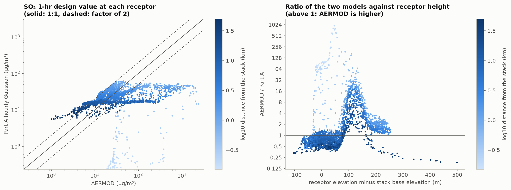

### Why AERMOD Is Higher: Terrain, Not Downwash

To identify why AERMOD predicts much higher concentrations, I carried out additional runs for the three short-term design values. These runs separately remove building downwash, remove terrain using `MODELOPT FLAT`, or remove both. Since Part A includes neither terrain nor building downwash, the additional runs make it possible to examine the effect of each feature separately.

| Set-up | SO₂ 1-hour | NO₂ 1-hour | PM₂.₅ 24-hour |
| :--- | ---: | ---: | ---: |
| Part A (no downwash, flat ground) | 61.1 | 31.3 | 0.481 |
| AERMOD regulatory run (downwash + terrain) | 2,400 | 758 | 12.3 |
| AERMOD, downwash, flat ground | 65.6 | 35.1 | 0.883 |
| AERMOD, no downwash, terrain | 2,580 | 800 | 14.4 |
| AERMOD, no downwash, flat ground | 46.0 | 25.4 | 0.832 |
| AERMOD regulatory run with the stack at its 75 m GEP height | 1,980 | – | – |

Values are the highest design values at any receptor, in µg/m³. The complete results, including the location of each maximum, are provided in `08_Python_Analysis/part_a_results/aermet/comparison_diagnostics.md`.

The graphs show the highest design value within each distance band. Orange and green distinguish runs with and without building downwash. Solid lines represent runs with terrain, while dashed lines represent flat-terrain runs. The Part A results are shown in blue.


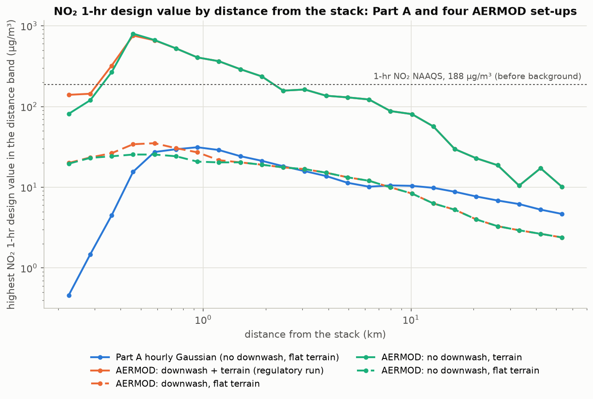

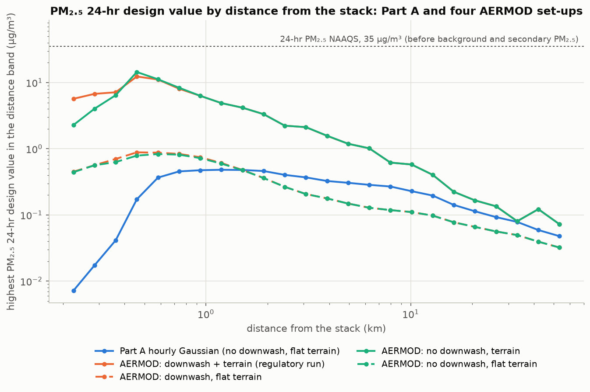

The maps below show the same five model configurations. For each pollutant, the colour scale is kept consistent across all five maps, so the same colour represents the same concentration in every map.

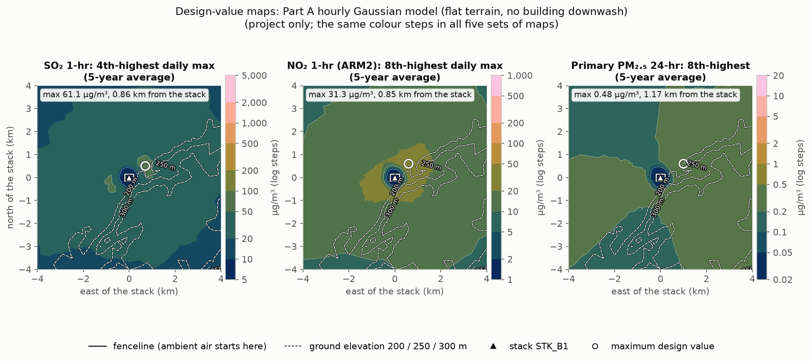

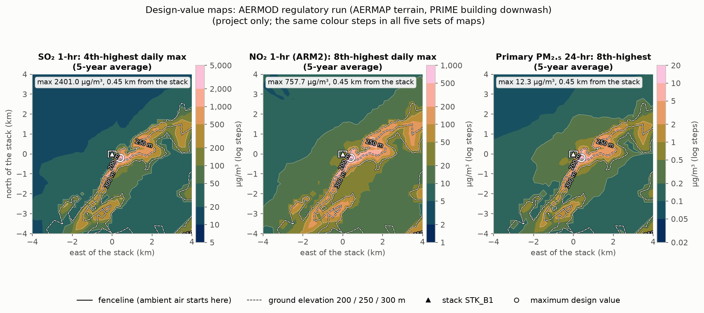

<details>
<summary>The three AERMOD test set-ups (click to open)</summary>

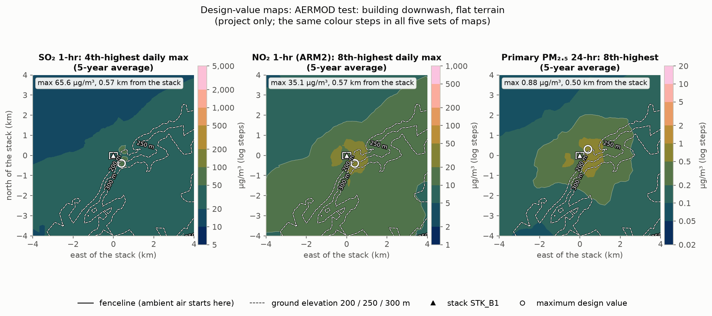

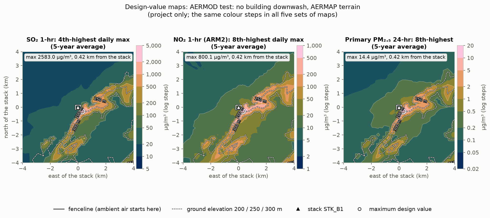

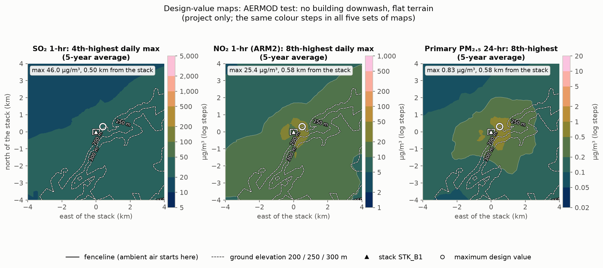

</details>

The test runs help separate the effects of terrain and building downwash:

* **All three pollutants show similar spatial patterns.** They are released from the same stack under the same meteorological conditions. Their concentrations differ because their emission rates differ, but the plume patterns are similar.
* **The models are reasonably close over flat terrain.** When terrain is switched off, AERMOD and Part A produce results within about a factor of two for this tall, buoyant stack. This indicates that the main difference is not simply the dispersion equations used by the two models.
* **Building downwash has a local effect.** It increases concentrations by up to about 2.5 times within roughly 0.4 km of the stack. It does not control the highest design values, which occur farther away near the ridge.
* **Terrain explains the large AERMOD concentrations.** During stable conditions, the plume remains at a relatively constant elevation. The ground 0.4–0.6 km from the stack rises to approximately the same elevation as the plume. In AERMOD, air below the dividing-streamline height, $H_c$, cannot pass over the hill. Much of the plume is therefore directed toward the hillside before it has dispersed. Part A assumes flat terrain and cannot represent this effect.
* **Increasing the stack to GEP height is not enough.** The ridge remains higher than the release point, even with a 75 m stack. The 1-hour SO₂ design value decreases by only about 18%.

### What This Means for the Permit

Based on the AERMOD results, Unit B1 cannot meet the modeled air-quality requirements at the proposed site in its current design. For the 1-hour SO₂ standard, the project contribution must remain below 183 µg/m³. This value is the NAAQS limit of 196.4 µg/m³ minus the assumed background concentration of 13.1 µg/m³. AERMOD predicts a project contribution of 2,400 µg/m³.

The SO₂ emissions would therefore need to be reduced by about 92% to meet this limit, for example by installing an effective flue-gas desulfurization system. The 1-hour NO₂ and 24-hour PM₂.₅ results also require substantial reductions. The main options are to reduce emissions significantly, move the stack away from the ridge, or combine both measures.

Part A does not identify this problem because it assumes flat terrain and does not include building downwash. Those assumptions omit the main factor controlling dispersion at this site. The comparison shows why a simplified Gaussian model is useful for learning and preliminary assessment, but a site with complex nearby terrain requires a regulatory model such as AERMOD that can account for terrain effects.

## What I Corrected from the First Version

The original version used the general modeling workflow and the correct averaging-time forms for SO₂ and NO₂. However, its reported results were not produced by AERMOD, and several input files were not compatible with the current EPA programs. The main changes are summarized below.

| Item | First version | This version |
| :--- | :--- | :--- |
| Figures | computed with one Gaussian formula (class B for every hour, plume rise capped at 45 m), not with AERMOD or hourly weather | hourly model over 5 years; every design value in its correct form |
| Met file | `APEX_2018_2022.SFC`: synthetic, one year only, no relative humidity column, constant pressure and cloud | documented synthetic 5-year file in AERMET format (Part A); real data through AERMET in Part B |
| Met period and data | 2018–2022; FSL upper air (no longer available); ISHD surface data (retired by NCEI) | 2021–2025; IGRA upper air; GHCNh surface data (AERMET 26135) |
| AERMET | three stages with the obsolete `MERGE` stage; no `ADJ_U*`, `THRESH_1MIN`, `SUB_CC`, `SUB_TT`, `UASELECT`; upper-air station without the required elevation | two stages with the recommended options |
| AERSURFACE | `ARID_NO`, legacy `AP` flag, NLCD 2011, one moisture case | `NONARID`, `VARYZ0`/`LOWZ0`, NLCD 2021, three moisture runs assigned to years |
| AERMINUTE | wrong `IFWGROUP` syntax, partial file list | correct syntax, every available month (57 of 60) |
| Receptors | overlapping grids, no fenceline, ±10 km | fenceline, nested grids and polar rings to 50 km, written by code for AERMAP and Part A alike |
| AERMOD | `SITEDATA` without on-site data; `NO2STACK` on the SO pathway; PVMRM with an unjustified in-stack ratio of 0.10; no PM₂.₅ runs; increments from a multi-year run | removed; ARM2 (Tier 2); PM₂.₅ runs; one run per year for H1H/H2H; optional OLM with the correct keywords |
| AERSCREEN | hand-written restart file that AERSCREEN cannot read | the prompt answers (AERSCREEN writes its own `aerscreen.inp`) |
| Limits | PM₂.₅ annual NAAQS 12 and SIL 0.3 µg/m³; Class I and III increments compared at near-field receptors | current values; Class II increments at the receptors, Class I through the Federal Land Managers |
| README | mentioned a Martins Creek benchmark and a ±50% AERSURFACE sensitivity that the code did not contain | describes only what the code does |

## How to Run

### Part A only (any computer with Python)

To run Part A, you need Python 3.9 or newer and the `numpy` and `matplotlib` libraries. No external data downloads are required:

```
pip install -r requirements.txt
cd 08_Python_Analysis
python run_part_a.py            # model, design values, tables and figures (about 1 minute)
python make_illustrations.py    # the concept illustrations
```

The tables go to `08_Python_Analysis/part_a_results/demo/` and the figures to `images/part_a/`.

### Part B: the full EPA chain (Windows)

The EPA modeling programs used in Part B run on Windows. Run the batch files in the order shown below. Wait for each program to finish before starting the next step. Do not run two steps at the same time. For example, simultaneous AERMAP runs can overwrite the same temporary files and cause both runs to fail.

| Step | File | What it does | Time |
| :--- | :--- | :--- | :--- |
| A | `A_download_data.bat` | downloads the EPA programs and all data into `Bin/` and `data/` (files already there are skipped; see [data/README.md](data/README.md)) | depends on the connection (about 600 MB) |
| B | `B_run_preprocessors.bat` | prepares the data, then runs AERSURFACE, AERMINUTE, AERMET, AERMAP and BPIPPRM | about 40 minutes, most of it AERMAP |
| C | `C_run_aermod.bat` | the 19 regulatory AERMOD runs, 6 at a time | about 12 minutes |
| D | `D_run_test_runs.bat` (optional) | the 10 test runs with downwash or terrain switched off, and the GEP stack | about 15 minutes |
| E | `E_make_figures.bat` | Python: concept illustrations, Part A, the AERMOD tables, the comparison and every figure | about 3 minutes |


## Limitations and Further Work

### Limitations

* **Synthetic meteorology in the initial Part A run:** These results demonstrate the calculation method. The site assessment should be based on the real-weather results in Part B.
* **Simplified treatment in Part A:** The Python model assumes flat terrain, does not include building downwash, and uses rural dispersion parameters. It therefore omits the terrain effect that controls the results at this site.
* **Pasquill–Gifford dispersion curves:** These curves were developed mainly from near-ground releases over relatively flat terrain and are most reliable over distances of about 10 km. The steady-state assumption also becomes less representative near the 30–50 km edge of the SIA. This limitation applies to AERMOD as well.
* **Mixing-layer treatment in Part A:** The ISC-style model treats the plume as either below or above the mixing-layer top. It does not represent partial plume penetration through the layer.
* **Background and nearby sources:** Background concentrations are illustrative, and emissions from nearby sources are not included.
* **Secondary PM₂.₅:** The Tier 1 estimate uses the most conservative hypothetical sources in the guidance, rather than sources selected specifically for the northeastern United States.
* **Emission profile:** Emission rates are assumed to remain at their maximum values during every hour of every year.

### Further Work

* **Evaluate design changes:** Reduce SO₂, NOx, and PM₂.₅ emissions using appropriate control technologies, such as a flue-gas desulfurization system, selective catalytic reduction (SCR), and improved particulate controls. Alternatively, assess a stack location farther from the ridge.
* **Improve the cumulative analysis:** Replace the illustrative background concentrations with representative monitored design values (EPA, 2024), and develop an emissions inventory for nearby sources within the SIA.
* **Refine the secondary PM₂.₅ estimate:** Use the MERPs hypothetical sources developed for the Northeast. The Federal Land Managers should also be consulted about potential impacts on the Brigantine Class I area.
* **Improve the NO₂ assessment:** If Tier 3 modeling is required, use measured in-stack NO₂/NOx ratios and hourly ozone data.
* **Complete a screening comparison:** Run AERSCREEN from `07_AERSCREEN/` and compare its results with the more detailed modeling.

## References

### Regulations and EPA guidance

* 40 CFR Part 50, National Primary and Secondary Ambient Air Quality Standards; 40 CFR 50.1(e), definition of ambient air.
* 40 CFR 51.100(ii), definition of good engineering practice stack height; 40 CFR 51.165(b)(2), significance levels; 40 CFR 52.21, Prevention of Significant Deterioration of air quality.
* 40 CFR Part 51, Appendix W, *Guideline on Air Quality Models*, as revised in 89 FR 95034 (November 29, 2024).
* U.S. EPA (2024). *Reconsideration of the National Ambient Air Quality Standards for Particulate Matter*, 89 FR 16202 (March 6, 2024).
* U.S. EPA (2024). *Review of the Secondary National Ambient Air Quality Standards for Oxides of Nitrogen, Oxides of Sulfur, and Particulate Matter*, final decision, 89 FR 105692 (December 27, 2024).
* U.S. EPA. *Alternative Demonstration Approach for the 2024 Secondary Sulfur Dioxide NAAQS under the PSD Program*, and *Alternative Demonstration Approach for the 1971 Secondary 3-Hour Sulfur Dioxide NAAQS under the PSD Program* (October 10, 2025).
* U.S. EPA (2010). *Applicability of Appendix W Modeling Guidance for the 1-hour NO₂ NAAQS* (June 28) and *for the 1-hour SO₂ NAAQS* (August 23); *General Guidance for Implementing the 1-hour NO₂ NAAQS in PSD Permits, Including an Interim 1-hour NO₂ SIL* (June 29); *Guidance Concerning the Implementation of the 1-hour SO₂ NAAQS for the PSD Program* (August 23).
* U.S. EPA (2011). *Additional Clarification Regarding Application of Appendix W Modeling Guidance for the 1-hour NO₂ NAAQS* (March 1).
* U.S. EPA (2013). *Use of ASOS Meteorological Data in AERMOD Dispersion Modeling* (March 8).
* U.S. EPA (2018). *Guidance on Significant Impact Levels for Ozone and Fine Particles in the PSD Permitting Program* (April 17), and its supplement for the 2024 PM₂.₅ NAAQS (April 30, 2024).
* U.S. EPA (2019). *Guidance on the Development of Modeled Emission Rates for Precursors (MERPs) as a Tier 1 Demonstration Tool for Ozone and PM₂.₅ under the PSD Permitting Program*, EPA-454/R-19-003, with the 2024 update memorandum.
* U.S. EPA (2019). *Revised Policy on Exclusions from "Ambient Air"* (December 2).
* U.S. EPA (2022). *Guidance for Ozone and Fine Particulate Matter Permit Modeling*, EPA-454/R-22-005.
* U.S. EPA (2024). *Guidance on Developing Background Concentrations for Use in Modeling Demonstrations*, EPA-454/R-24-003.
* FLAG (2010). *Federal Land Managers' Air Quality Related Values Work Group (FLAG) Phase I Report — Revised (2010)*. Natural Resource Report NPS/NRPC/NRR—2010/232.

### EPA model documentation

* U.S. EPA (2024). *AERMOD Model Formulation*, EPA-454/B-24-010; *User's Guide for the AMS/EPA Regulatory Model (AERMOD)*, EPA-454/B-24-007; *AERMOD Implementation Guide*, EPA-454/B-24-009; *AERMOD Quick Reference*.
* U.S. EPA (2026). *User's Guide for the AERMOD Meteorological Preprocessor (AERMET)*, version 26135.
* U.S. EPA (2026). *User's Guide for AERSURFACE Tool*, EPA-454/B-26-007.
* U.S. EPA (2024). *User's Guide for the AERMOD Terrain Preprocessor (AERMAP)*, EPA-454/B-24-008.
* U.S. EPA (2023). *AERMINUTE User's Guide*, EPA-454/B-23-007.
* U.S. EPA (2021). *AERSCREEN User's Guide*, EPA-454/B-21-005.
* U.S. EPA (1993). *User's Guide to the Building Profile Input Program*, EPA-454/R-93-038.
* U.S. EPA (1995). *User's Guide for the Industrial Source Complex (ISC3) Dispersion Models, Volume II: Description of Model Algorithms*, EPA-454/B-95-003b.
* U.S. EPA (2015). *Technical Support Document for NO₂-related AERMOD Modifications*, EPA-454/B-15-004.
* RTP Environmental Associates (2013). *Ambient Ratio Method Version 2 (ARM2) for use with AERMOD for 1-hr NO₂ Modeling: Development and Evaluation Report*.

### Textbooks

* Arya, S.P. (1999). *Air Pollution Meteorology and Dispersion*. Oxford University Press.
* De Visscher, A. (2014). *Air Dispersion Modeling: Foundations and Applications*. Wiley.
* Seinfeld, J.H., & Pandis, S.N. (2016). *Atmospheric Chemistry and Physics: From Air Pollution to Climate Change* (3rd ed.). Wiley.
* Stull, R.B. (1988). *An Introduction to Boundary Layer Meteorology*. Kluwer Academic.
* Turner, D.B. (1994). *Workbook of Atmospheric Dispersion Estimates: An Introduction to Dispersion Modeling* (2nd ed.). CRC Press.

### Papers

* Briggs, G.A. (1969). *Plume Rise*. USAEC Critical Review Series, TID-25075.
* Briggs, G.A. (1974). *Diffusion Estimation for Small Emissions*. ATDL Contribution File No. 79, NOAA.
* Briggs, G.A. (1975). Plume rise predictions. In *Lectures on Air Pollution and Environmental Impact Analyses*, American Meteorological Society, 59–111.
* Carson, D.J. (1973). The development of a dry inversion-capped convectively unstable boundary layer. *Quarterly Journal of the Royal Meteorological Society*, 99, 450–467.
* Chang, J.C., & Hanna, S.R. (2004). Air quality model performance evaluation. *Meteorology and Atmospheric Physics*, 87, 167–196.
* Cimorelli, A.J., et al. (2005). AERMOD: A dispersion model for industrial source applications. Part I: General model formulation and boundary layer characterization. *Journal of Applied Meteorology*, 44, 682–693.
* Golder, D. (1972). Relations among stability parameters in the surface layer. *Boundary-Layer Meteorology*, 3, 47–58.
* Holtslag, A.A.M., & van Ulden, A.P. (1983). A simple scheme for daytime estimates of the surface fluxes from routine weather data. *Journal of Climate and Applied Meteorology*, 22, 517–529.
* Paulson, C.A. (1970). The mathematical representation of wind speed and temperature profiles in the unstable atmospheric surface layer. *Journal of Applied Meteorology*, 9, 857–861.
* Perry, S.G., et al. (2005). AERMOD: A dispersion model for industrial source applications. Part II: Model performance against 17 field study databases. *Journal of Applied Meteorology*, 44, 694–708.
* Podrez, M. (2015). An update to the ambient ratio method for 1-h NO₂ air quality standards dispersion modeling. *Atmospheric Environment*, 103, 163–170.
* Qian, W., & Venkatram, A. (2011). Performance of steady-state dispersion models under low wind-speed conditions. *Boundary-Layer Meteorology*, 138, 475–491.
* Schulman, L.L., Strimaitis, D.G., & Scire, J.S. (2000). Development and evaluation of the PRIME plume rise and building downwash model. *Journal of the Air & Waste Management Association*, 50, 378–390.
* van Ulden, A.P., & Holtslag, A.A.M. (1985). Estimation of atmospheric boundary layer parameters for diffusion applications. *Journal of Climate and Applied Meteorology*, 24, 1196–1207.
* Venkatram, A. (1980). Estimating the Monin-Obukhov length in the stable boundary layer for dispersion calculations. *Boundary-Layer Meteorology*, 19, 481–485.
* Weil, J.C., & Brower, R.P. (1983). *Estimating Convective Boundary Layer Parameters for Diffusion Applications*. Maryland Power Plant Siting Program, PPSP-MP-48.

### Data (Part B)

* NOAA NCEI: Global Historical Climatology Network hourly (GHCNh); ASOS 1-minute data (DSI-6405); Integrated Global Radiosonde Archive, version 2.2 (Durre et al.); Global Summary of the Year.
* NWS: *ASOS Sites by Equipment* (March 18, 2025), for the anemometer height.
* MRLC: National Land Cover Database 2021 (land cover, impervious surface, tree canopy).
* USGS: 3D Elevation Program, 1 arc-second DEM.

### Python libraries and colour maps

* NumPy (Harris et al., 2020) and Matplotlib (Hunter, 2007).
* Crameri, F. (2018). *Scientific colour maps* (batlow). Zenodo, doi:10.5281/zenodo.1243862; Crameri, F., Shephard, G.E., & Heron, P.J. (2020). The misuse of colour in science communication. *Nature Communications*, 11, 5444.
